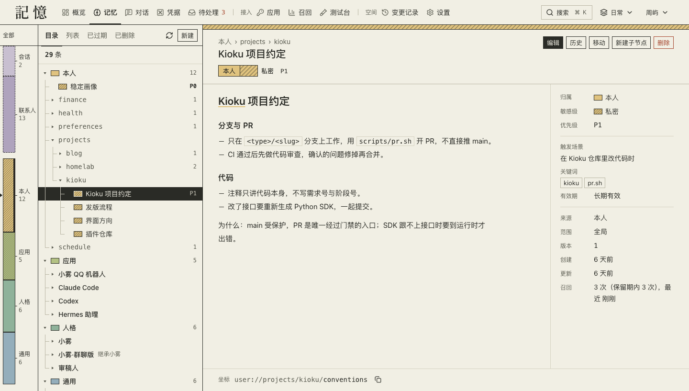
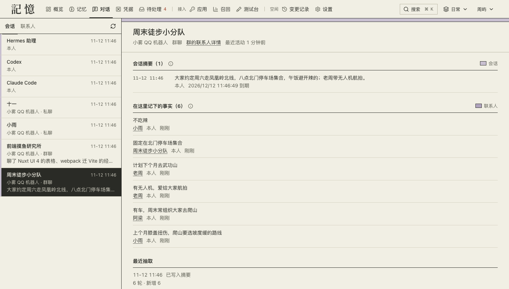
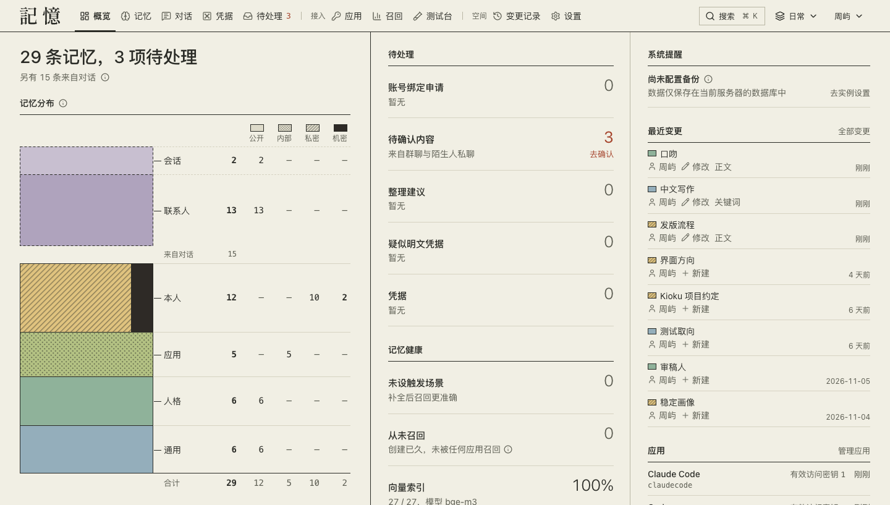
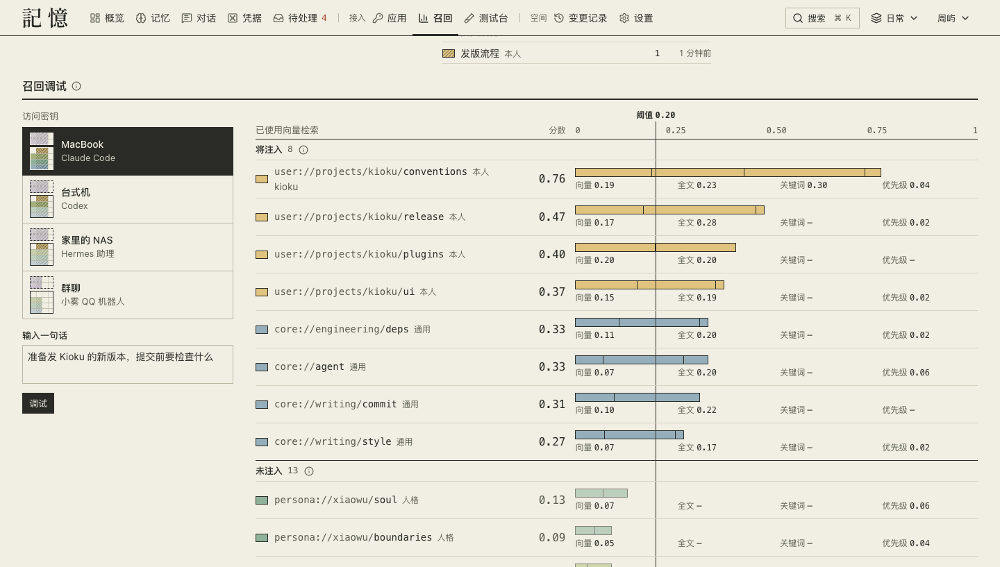

<p align="center"></p>

<h1 align="center">Kioku · 記憶</h1>

<p align="center"><b>记忆有归属，也有深浅。</b></p>

<p align="center">
同一个人格，接进编码 agent、个人助理与群聊机器人。<br>
每段记忆落在自己的地层里，换一个场合，想起的就不一样。
</p>

<p align="center">
<a href="LICENSE"></a>


</p>

<p align="center">
<a href="#快速开始">快速开始</a> ·
<a href="#接入">接入</a> ·
<a href="docs/design.md">设计</a> ·
<a href="docs/deploy.md">部署与运维</a> ·
<a href="https://github.com/lonelyman0108/kioku-plugins">插件</a>
</p>

<p align="center">
<picture>
<source media="(prefers-color-scheme: dark)" srcset="docs/screenshots/memories-dark.png">

</picture>
</p>

## 三个场合

> **在 Claude Code 里定下的项目约定**，第二天换到 Codex，它照样记得。
>
> **群里的机器人借用同一个人格说话**，口吻一致，却读不到你的私人记忆。
>
> **群友在这个群聊过的事**，记在这个群友名下；换个群，不会串。

靠的不是提示词里一句「请勿泄露」，而是检索之前服务端就已裁掉：访问密钥定上限，会话上下文再收一次，PostgreSQL 行级安全兜底。

<p align="center">
<picture>
<source media="(prefers-color-scheme: dark)" srcset="docs/screenshots/conversations-dark.png">

</picture>
</p>

## 地层与记忆圈

```text
  会话     这一段对话              ┐ 从对话里记下
  联系人   群友、群                ┘
 ┄┄┄┄┄┄┄┄┄┄┄┄┄┄┄┄┄┄┄┄┄┄┄┄┄┄┄┄┄┄┄┄┄
  个人圈   每人唯一，跨圈随身      ┐
  共享客场 关联的另一个记忆圈      │ 词条（m-xxxxxx）+ 多切面变体
  人格     独立人格，按设定键覆盖  │ + 双链 [[m-xxxxxx]]
  主场圈   当前接入的共享/个人圈   ┘
```

越往下越通用。所有词条统一分配不可变短 ID（`m-xxxxxx`）并支持按「场域、环境、客户端、项目及自定义维度」挂接多套变体切片；每条记忆另有一个敏感级：公开、内部、私密、机密，机密与凭据对客场及无权上下文硬拒绝，且机密只存密文。

<p align="center">
<picture>
<source media="(prefers-color-scheme: dark)" srcset="docs/screenshots/overview-dark.png">

</picture>
</p>

## 为什么是 Kioku

- **隔离在服务端，不在提示词。** 访问密钥绑定接入实例作为透镜（1 主场圈 + N 客场圈 + 静态场域锁），会话上下文再收一次，PostgreSQL 读写双变量行级安全兜底。
- **短 ID 与多切面变体。** 同主题跨设备或跨环境约定落成同一词条下的多张 `when` 切片，按在场切面合并或互斥剥离；正文 `[[m-xxxxxx]]` 建立跨圈 1 跳共振双链。
- **人格与群聊双模式。** 独立人格沿继承链按设定键覆盖，可按群覆写、配单群强隔离锁，并在「严格按群隔离」与「拟人跨群识人」之间即时切换。
- **不会写记忆的模型也有记忆。** 从对话里自动抽取联系人事实与会话摘要，事实全量向量化、摘要近期注入，后台整理提出多变体合并与切面补标建议。
- **事实会过期。** 新事实取代旧事实时标记失效，每一版都留着，可以恢复。
- **密码不进记忆。** 正文只留 `{{cred:<标识>}}`，值在 Kioku 或连接的 Bitwarden；`kioku run` 经环境变量交给命令。
- **数据不出门。** 两个容器，不向第三方请求字体与图标，加密备份到兼容S3的对象存储。

## 快速开始

```bash
curl -fsSLO https://raw.githubusercontent.com/lonelyman0108/kioku/main/compose.yaml
curl -fsSL -o .env https://raw.githubusercontent.com/lonelyman0108/kioku/main/.env.example   # 按注释生成密码与主密钥
docker compose up -d
```

打开 `http://127.0.0.1:18920`，输入日志里的初始化码（`docker compose logs kioku`），建第一个账号与记忆圈。用局域网的 `http://` 地址访问、要经 HTTPS 对外、从旧版 Kioku 迁移、或想从源码构建时，先看 [部署与运维](docs/deploy.md)。

## 接入

```bash
npx @kioku-memory/cli
```

不带参数就是交互式向导：扫出本机装了哪些客户端，选好要接的几个，去浏览器确认一次就写好配置，访问密钥全程不显示。手头没有服务器的，向导里也可以顺带用 Docker 在本机起一个。

| 平台 | 启动加载 | 每轮召回 | 会话摘要 | 记忆工具 |
|---|:-:|:-:|:-:|:-:|
| Claude Code | ● | ● | ● | ● |
| Codex | ● | ● | ● | ● |
| Gemini CLI | ● | ● | ● | ● |
| Antigravity | ● | ● | ● | ● |
| OpenCode | ● | ● | ● | ● |
| pi | ● | ● | ● | ● |
| Hermes | ● | ● | ● | ● |
| OpenClaw | ● | ● | ● | ● |
| DeepSeek Harness | ● | ● | ● | ● |
| AstrBot（群聊机器人） | 人格 | ● | 对话抽取 | — |
| 任意 MCP 客户端 | — | — | — | ● |

<p align="center">
<picture>
<source media="(prefers-color-scheme: dark)" srcset="docs/screenshots/recall-dark.png">

</picture>
</p>

各平台的安装见 [kioku-plugins](https://github.com/lonelyman0108/kioku-plugins)；MCP 地址是 `/v1/mcp`，其余接口见 `/v1/openapi.json`。用过 Lore 的：[从 Lore 迁移](docs/migrate-from-lore.md)。

## 开发

```bash
scripts/bootstrap.sh && pnpm install
pnpm dev                      # 后端 18920，管理界面 5173
scripts/check.sh              # 门禁，与 CI 一致
```

| 目录 | 内容 |
|---|---|
| `apps/server` | 后端：Hono + zod-openapi |
| `apps/web` | 管理界面：Vue 3 + Nuxt UI 4 |
| `packages/contracts` | 前后端与 SDK 共用的 zod 契约 |
| `sdks/python` | 由 OpenAPI 生成的 Python 客户端 |

规范见 [CONTRIBUTING.md](CONTRIBUTING.md)、[AGENTS.md](AGENTS.md)，文档索引见 [docs/README.md](docs/README.md)，版本变化见 [CHANGELOG.md](CHANGELOG.md)。

## 许可证

[Apache-2.0](LICENSE)。部分算法源自 [Lore](https://github.com/FFatTiger/lore)（MIT），声明见 [NOTICE](NOTICE)。
