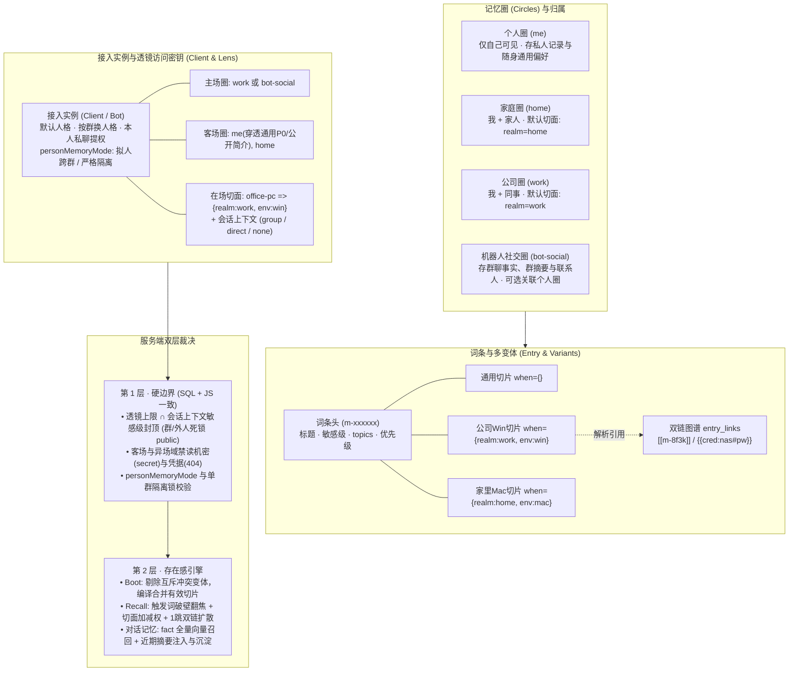

# 记忆圈与切面架构重构 计划（Kioku）

> 一个主题一份计划，覆盖从决策到收尾的全过程，持续勾选。
> 状态：进行中　　开始：2026-11-18　　负责人：agent（维护者审阅）
> 全部完成后，文件头改为「已完成 YYYY-MM-DD」，用 `git mv` 移到 `docs/archive/plans/`。

## 状态总览

更新于 2026-11-18：在完成上一轮「归属 × 敏感级」改版后，维护者进一步梳理了多端与多场景下的真实痛点：一方面，同一用户在多台物理机器（如家里 Mac 与公司 Windows）、多个代码项目、多生活圈（个人、家庭、公司）之间切换时，既需要共享通用习惯与跨圈按需联想，又必须对半受信设备（公司电脑）锁死私密凭据与机密记忆；另一方面，未来接入多群与私聊的聊天机器人时，既要支持「读取主人公开/内部记忆」或「使用全新独立记忆」两种形态，也要实现真正不遗忘的远期事实召回、可切换的跨群识人与强隔离保护，并防止访问密钥轮换导致群规则与会话断链；同时卸下 Lore 遗留的 `domain://a/b/c` URL 路径树包袱。经多轮讨论，决定实施一次彻底重构，以「记忆圈（Circle）+ 轻量接入实例（Client）+ 自动短 ID 多变体词条（Entry & Variants）+ 多维切面透镜（Facet Lens）+ 双链语境扩散（Wiki-Link）」取代原有 URL 路径树与六层归属模型，并提供从 Lore 及旧版 Kioku 平滑迁入的工具。

| 期 | 进度 | 状态 | 结束标志 |
|---|---|---|---|
| 1 · 设计定稿 | 1/2 | 进行中 | `docs/design.md` 与架构 ADR 定稿，维护者审过（U01） |
| 2 · 契约与库结构基线 | 0/4 | 未开始 | `packages/contracts` 与全新迁移基线落地，空库可迁移，RLS 一致性测试通过 |
| 3 · 记忆圈与权限硬边界 | 0/4 | 未开始 | 记忆圈成员、轻量接入实例、主客场跨圈读取、会话封顶与双模式隔离测试全部通过 |
| 4 · 词条多变体与双链 | 0/5 | 未开始 | 自动短 ID 生成、多变体 CRUD、信封加密与 `[[m-xxxxxx]]` 双链索引测试通过 |
| 5 · 切面引擎与主客场召回/启动编译 | 0/5 | 未开始 | 词表蕴含展开、提问破壁切焦、启动编译合并、`fact` 向量召回与摘要沉淀全部通过 |
| 6 · MCP/REST/SDK 与整理升级 | 0/5 | 未开始 | 新版 MCP 工具、REST 与 OpenAPI、Python SDK、新版整理建议（`Dream`）与测试台全部通过 |
| 7 · 管理界面重构 | 0/6 | 未开始 | 动态分组目录、多变体对比编辑器、词表配置、接入实例与透镜密钥、召回调试走查通过 |
| 8 · 双源迁移工具与收尾 | 0/4 | 未开始 | 旧版 Kioku 与 Lore 双源迁移工具验证通过，线上重建迁入（U02）与插件同步（U03）完成 |

## 决策摘要

| # | 决策 | 采纳 | 可推翻条件 |
|---|---|---|---|
| 1 | **废除 URL 路径树，改用自动短 ID + 标题寻址**：取消 `domain://a/b/c` 伪协议坐标、目录层级与英文标识必填要求；所有记忆统一由服务端生成不可变短 ID `m-<6位无歧义Base30>`（字符集 `23456789abcdefghjkmnpqrstvwxyz`，排除 `0/o/1/i/l/u` 防人工抄写混淆，碰撞自动重试，输入大小写不敏感、存储统一小写），配合自然语言标题寻址；彻底移除 `claimUri`、`uriConflicts`、`409 坐标冲突` 与 `move` 搬家断链；保留 `legacy_uris` 表映射迁入的旧坐标以做兜底解析 | 维护者（2026-11-18）；彻底消除命名负担与树状分类单亲限制 | 短 ID 在超大规模圈子内若需要更长编码，可无痛扩展后缀长度并保留旧正则兼容 |
| 2 | **顶层归属重构为「记忆圈（Circle）+ 正交切面 + 独立人格」，接入层保留轻量 `clients`**：取代原有绝对孤岛 `Space` 内套六层归属的结构。每个账号自带唯一不可删的**个人圈（`me`）**（存放私人记忆、随身通用偏好、个人涉公/涉家私下记录），并可创建/加入多个**共享圈**（家庭圈、公司圈等，成员角色保留所有者/编辑者/查看者，离开保留 30 天）；词条分类上不再设立 `app://` 归属层，而是化简为内置 `runtime` 切面维度（允许同一条规则同时面向多个客户端如 `[claudecode, codex]`）；原 `persona://` 独立为纯粹的**人格模块**（管理灵魂设定、口吻与继承链，按设定键覆盖）。同时在接入管理层保留轻量的**接入实例（`clients`）与按群规则（`client_group_rules`）**，专门承载默认人格、按群换人格、单群隔离锁、本人私聊提权与跨群识人模式，访问密钥挂在接入实例之下，密钥轮换时群规则、历史会话与 `/bind` 绑定不断链 | 维护者（2026-11-18）；兼顾极简词条模型、物理分圈协作与聊天机器人密钥轮换不断链 | — |
| 3 | **记忆物种统一与真持久记忆**：正式词条（`entry`）、联系人/群事实（`fact`）与会话摘要（`episode`）共用同一套短 ID（`m-xxxxxx`）与底层词条模型，消除过去抽取内容无地址、无向量、无法统一检索的割裂状态。为非机密且有效的 `entry` 与 `fact` 统一生成 1024 维向量与全文索引，解决旧版超过 8 条直连上限即失忆的问题，使数月乃至数年前的远期事实可按作用域语义召回；群聊与私聊支持将本群/此人最近 2–3 段会话摘要作为近期话题背景注入（压成单行并声明仅作参考、严禁当作系统指令）；会话摘要到期清理前，由后台整理任务（`Dream`）自动扫描并将反复提及的重要事件提炼沉淀为长期有效的 `fact` 或 `entry` | 维护者（2026-11-18）；统一寻址与持久检索基座，避免机器人长期运行后遗忘远期记忆 | 若超大规模群聊摘要过密，可对低价值 `episode` 调整保留期或摘要密度 |
| 4 | **一词条多切面变体（Contextual Variants）**：词条由「词条头（`entries`）+ 1..N 个变体切片（`entry_variants`，带 `when` 切面条件与正文）」组成。普通记忆退化为单个无条件切片（`when = {}`），读写心智零增加；跨环境同主题规范（如 Git 提交规范、终端环境、常用网络拓扑）挂多个切面切片。启动加载按当前上下文剥离相斥切片、编译合并通用底座与匹配切片；向量与全文索引按切片粒度建立，检索聚合回词条，`kioku_get` 默认返回当前匹配切片并附注其余变体切面，支持 `allVariants: true` 查看全量。机密级（`secret`）词条下全部变体正文统一信封加密（`aad` 绑定 `variant_id`），标题若与任一变体首个 `#` 标题相同则回退为短 ID | 维护者（2026-11-18）；解决同主题跨机器/跨场域规范打架问题 | 若某个领域变体过重需独立权限，拆分为两条关联词条即可 |
| 5 | **内置四大维度 + 自定义维度词表**：内置 `realm`（场域：公司/家里/个人）、`env`（环境与设备：win/mac/linux/wsl/具体机器）、`runtime`（客户端家族）、`project`（项目仓库名，随上报自动登记），支持自定义维度（如 `role` 角色：开发/写作/理财）。维度支持同维模式（`exclusive` 相斥聚焦 / `additive` 仅加权）、取值**蕴含展开 `implies`**（如 `office-pc` 展开 `env:win` + `realm:公司`；项目 `kioku` 展开 `realm:个人` + `role:开发`）与**口语触发词 `aliases`**（用于提问破壁）。记忆圈可设**默认切面**（如公司圈默认 `realm:公司`），圈内词条免重复打标；非互斥主题归类用 `topics` 标签，界面与浏览工具支持按任意维度或主题动态聚合成树 | 维护者（2026-11-18）；受控词表防模型乱造同义标签，蕴含与别名兼顾灵活与低运维成本 | — |
| 6 | **访问密钥升级为多圈主客场透镜（Lens）**：每个访问密钥隶属于一个 `client` 接入实例，并绑定 1 个**主场圈** + N 个同账号所属**关联客场圈**（支持配置纯只读，或允许显式传目标圈跨圈写入）+ **本终端在场切面 `contextFacets`** + 继承并可选覆盖的**有效人格**。默认写入落主场圈，显式传入目标圈时可跨圈写入；关联个人圈作客场时，在无上下文（如编码 Agent）且允许读个人圈的请求下，个人圈中无任何切面限制的纯通用 P0 词条自动穿透进入启动加载 | 维护者（2026-11-18）；一个终端访问密钥即可装配完整的跨圈视野与在场环境 | 若未来需按角色限制外部成员的关联圈视野，仅在 `Lens` 解析层校验即可 |
| 7 | **存在感双层引擎：启动相斥隐身 + 召回浮动加权与点名破壁**：启动加载（`boot`）剔除任一互斥维度发生冲突的切片；召回（`recall`）仅在语义/全文/关键词基础分达到相关性门槛（如 `0.12`）后才叠加切面亲和分（同维交集加分、同维无交集衰减、客场未点名微幅折减）；当用户提问命中口语触发词（如「家里」「Mac」）时，当轮动态翻转或追加对应维度的焦点切面，实现跨场域、跨圈精准唤醒，召回调试台完整展示 `facet` 与 `link` 得分明细 | 维护者（2026-11-18）；兼顾主场高存在感与跨界可查、同时防噪音靠标签分硬凑 | 亲和权重与相关性门槛可在实例高级设置调优 |
| 8 | **知识软互通、秘密硬隔离与会话上下文封顶**：服务端 JS `canRead`、SQL `readableConditions` 与凭据 `credentialDenial` 同步强制「透镜边界 ∩ 会话上下文规则」：本机无上下文请求按透镜上限执行（普通记忆可跨客场圈或异场域破壁读取，**机密 `secret` 与全部凭据 `{{cred:...}}`** 在客场圈及同圈异 `realm` 一律返回 404）；**群聊（`group`/`channel`）与外人私聊（非本人 `direct`）最高敏感级硬封顶为 `public`（公开）**——即使机器人关联了主人个人圈作客场，群友在提问中点名触发词破壁也只能读到明确设为 `public` 的词条，`internal` / `private` / `secret` 与凭据一律 404；**本人私聊**（联系人已绑定「这是我」且接入实例开启本人私聊提权）放宽至 `internal`（内部） | 维护者（2026-11-18）；在半受信电脑及多群机器人场景下同时守住信息安全边界 | — |
| 9 | **双链图谱 `[[m-xxxxxx]]` + 1 跳语境激活扩散**：写入时线性扫描正文中的 `[[m-xxxxxx]]` 或 `[[m-xxxxxx|显示文字]]` 维护 `entry_links` 引用边表（`secret` 机密词条与 `untrusted` 未确认来源内容均不写明文出链索引，机密降级时补回）；输出时仅对调用方当前可读的目标词条实时拼补最新标题；召回对高分种子词条检查 1 跳双向可读邻居（严格受当前有效 `Access` 过滤，绝不将非公开词条顺带带入群聊），将与当前在场切面同频共振的邻居衰减并入最终结果（标记 `via: link`） | 维护者（2026-11-18）；跨场域联动联想且杜绝未确认内容污染双链或越权泄漏 | 暂限 1 跳防扩散爆炸与延迟上升 |
| 10 | **模型按语义打标 + 整理巡检补标**：写入不强制全盘继承当前访问密钥的全部标记，由模型依据受控词表与系统指引按语义判断（通用技术经验留空，系统差异标 `env`，特定场域标 `realm`）；后台整理（`Dream`）新增「漏标补标」「同主题独立卡合并为多变体词条」「跨项目共性去标上浮」「到期摘要提炼沉淀」四类建议 | 维护者（2026-11-18）；防止在公司写下的通用编程技巧被永久锁死在公司场域 | — |
| 11 | **本机会话摘要细分**：不带会话上下文的编码会话按 `(接入实例, 所属成员, 设备环境标识, 项目名)` 归并（取代原仅按 `(应用, 成员)` 归并），彻底消除多台电脑与同机多仓库之间的会话摘要串台 | 维护者（2026-11-18） | — |
| 12 | **重建迁移基线 + 双源无损迁入工具**：数据库迁移文件重来一份干净基线；提供「旧版 Kioku 导出文件 / 旧库直连迁入」与「Lore 导出文件 / 直连迁入」两条确定性转换流水线，自动拆分原空间共享与个人记忆至对应记忆圈、将原 `apps` 转为 `clients` 与 `runtime` 切面、把原多级路径转为 `topics` 与 `legacy_uris`、按新规则重绑机密与凭据加密 `aad` | 维护者（2026-11-18）；彻底卸下历史兼容包袱并保证老数据零丢失 | — |
| 13 | **聊天机器人双形态与可配置「拟人跨群识人 / 严格隔离」模式**：机器人接入支持两类记忆圈配置——①**独立记忆**：新建专属圈且不关联客场圈，拥有完全独立的群友网络与世界观；②**关联主人记忆**：以机器人专属社交圈为主场圈（存放群聊事实、群摘要与联系人），将主人的个人圈挂为只读客场圈（群友对话不污染主人个人圈，安全读取公开/提权后的内部记忆）。同时在接入实例提供可随时切换的 **`personMemoryMode`**（**`persona_shared` 拟人跨群识人** vs **`strict` 严格按群隔离**，并支持在按群规则中将特定群单独标为 `isolateGroupMemory` 单群强隔离）：底层写入始终如实记录每条记忆的 `origin_scope`（`group:<群ID>` 或 `direct:<人ID>`），切换模式无需迁移历史即刻生效；私聊记忆（`direct:<人ID>`）以及关于群本身的事实（`subject.kind = 'group'`）与群会话摘要（`episode`）在两种模式下均严格锁死在原作用域，绝不流入其他群；开启 `persona_shared` 时，同一接入实例下某人在非隔离群中产生的个人事实（`kind = 'fact'` 且 `subject.kind = 'person'`）可在该机器人的其他非隔离群及与该人的私聊中被召回与注入，跨群来源在召回时带轻微折减（如 `-0.06`）并标注 `[其他群印象]`，开启单群隔离锁或切回 `strict` 时立即收紧为只读本群 | 维护者（2026-11-18）；兼顾「多群认出老熟人」的拟人体验与「随时切回严格防社死隔离」的可控性 | — |

长期有效的架构决策在各期落地前同步沉淀至 `docs/adr/`。

---

## 架构设计详述

### 一、整体概念拓扑与双层引擎

---

### 二、核心数据表结构草案

表分类沿用 Kioku 既有的安全模型：**身份与路由配置表**（无统一 `circle_id` 隔离，或需跨圈校验）与**内容表（全部带 `circle_id`，全部纳入 `RLS_TABLES` 并强制启用 PostgreSQL RLS `app.circle_id`）**。因为访问密钥可同时查主场圈与关联客场圈，跨圈查询时在 `withCircles(db, allowedCircleIds, fn)` 事务内以 `SET LOCAL app.allowed_circles = '<uuid1>,<uuid2>,...'` 授权当前请求可访问的圈子集合，依然由数据库 RLS 兜底物理防串库。

#### 1. 身份、记忆圈、人格与接入实例表

| 表名 | 归类 | 关键字段与约束 | 说明 |
|---|---|---|---|
| `circles` | 身份表 | `id`、`slug`（唯一可读短标如 `me-lm` / `home` / `work` / `bot-social`）、`name`、`kind`（`personal \| shared`）、`owner_account_id`（个人圈唯一，触发器禁止删除个人圈）、`default_facets`（`jsonb`，如 `{ realm: ['work'] }`）、`extraction_monthly_tokens`、`extraction_daily_writes`、`advanced`、`privacy` | 取代原 `spaces`；每个账号创建时自动生成唯一个人圈，计入或不单独占共享名额按配额规则设定 |
| `circle_members` | 身份表 | `(circle_id, account_id)` 主键、`role`（`owner \| editor \| viewer`）、`dream_private` | 个人圈仅本人一条记录；离开共享圈仍沿用 `circle_departures` 保留 30 天（`DEPARTURE_RETENTION_DAYS`） |
| `personas` | 内容表（RLS） | `id`、`circle_id`、`slug`、`name`、`extends_id`（最多 8 层）、`description` | 人格独立于词条，只承载灵魂与口吻；另配 `persona_traits` 表按 `(persona_id, trait_key)` 存储各设定段，子人格按 `trait_key` 覆盖祖先 |
| `clients` | 内容表（RLS） | `id`、`circle_id`、`slug`、`name`、`runtime_family`、`owner_account_id`、`default_persona_id`、`config`（含 `elevateOwnerDirect`、`personMemoryMode: 'persona_shared' \| 'strict'`、`recordPrompt`） | 轻量接入实例外壳（不进词条归属层），承载机器人的默认人格、提权开关、跨群识人模式与会话归属；密钥轮换时配置与历史不丢失 |
| `client_group_rules` | 内容表（RLS） | `(client_id, group_subject_id)` 主键、`circle_id`、`persona_id`（可空，按群覆盖人格）、`isolate_group_memory`（`boolean`，单群强隔离锁） | 为指定群或频道单独指定人格，或在「拟人跨群识人」模式下把个别敏感群单独锁死为仅限本群记忆 |

#### 2. 切面词表与词条多变体表

| 表名 | 归类 | 关键字段与约束 | 说明 |
|---|---|---|---|
| `facet_dimensions` | 身份/实例+圈表 | `id`、`scope_circle_id`（空为全实例内置，非空为圈级自定义）、`key`（`realm \| env \| runtime \| project \| <custom>`）、`name`、`match_mode`（`exclusive \| additive`）、`auto_register`（`boolean`，`project` 为 true） | 区分互斥聚焦维（`realm`、`env`、`runtime`、`project`）与非互斥叠加维；每圈总维度有合理上限 |
| `facet_terms` | 身份/实例+圈表 | `id`、`dimension_id`、`slug`、`label`、`implies`（`jsonb` 展开表，如 `{ env: ['win'], realm: ['work'] }`）、`aliases`（`text[]`，口语触发词） | 受控词表，防模型拼写分裂；展开后自动闭包检测禁止循环蕴含 |
| `entries` | 内容表（RLS） | `id`、`circle_id`、`short_id`（`m-[2-9a-hjkmnp-tv-z]{6}`，圈内或全局唯一索引）、`kind`（`entry \| fact \| episode`）、`title`、`sensitivity`、`provenance`、`origin_scope`、`owner_account_id`、`subject_id`、`conversation_id`、`topics`（`text[]`）、`priority`、`disclosure`、`valid_from`、`valid_to`、`expires_at`、`version`、`deleted_at` | 彻底去掉 `domain`、`path`、`app_id`、`persona_id`、`form` 割裂；`entries` 保存词条元信息与权限字段；`fact` / `episode` 与 `entry` 同表同短 ID |
| `entry_variants` | 内容表（RLS） | `id`、`circle_id`、`entry_id`、`when`（`jsonb`，格式 `{ realm?: string[], env?: string[], ... }`）、`when_signature`（规范化后的哈希或稳定文本，确保同一词条下 `when` 不重复）、`sort_order`、`content`（明文）、`ciphertext` / `wrapped_key` / `key_id`（机密级加密，`aad = variant:<id>`）、`sensitive_*`、`plaintext_ignored_hash`、`fts`（`tsvector` 生成列：拼接词条 `title` + `disclosure` + `when` 标签名 + 切片 `content`） | 普通词条仅 1 行（`when = {}`）；多变体词条拥有 1 行通用底座 + N 行条件切片；`entries.sensitivity = 'secret'` 时所有切片强制加密，否则全部明文 |
| `entry_embeddings` | 内容表（RLS） | `(variant_id, model)` 主键、`circle_id`、`entry_id`、`content_hash`、`embedding`（1024 维 HNSW） | 为所有非机密且有效的 `entry` 与 `fact` 切片生成向量（解决机器人超过 8 条直连上限即失忆的问题），召回时按 `entry_id` 聚合取最高匹配切片 |
| `entry_links` | 内容表（RLS） | `(source_entry_id, target_short_id)`、`circle_id`、`target_circle_id`（可空，支持跨圈双链）、`target_entry_id`（解析后的缓存指针，允许悬空链） | 每次写入线性扫描正文中 `[[m-xxxxxx]]` 与 `[[m-xxxxxx\|别名]]` 重写；**`secret` 机密词条与 `provenance = 'untrusted'` 写入的内容均不写明文出链**，防止未确认内容污染图谱或越权扩散 |
| `legacy_uris` | 内容表（RLS） | `id`、`circle_id`、`legacy_uri`（如 `user://projects/kioku/deploy_steps`）、`entry_id`、`source`（`lore \| kioku-v1`） | 仅用于迁移兜底：`kioku_get` 或搜索传入旧式 URI 时自动重定向查找对应 `short_id` |

#### 3. 透镜访问密钥与细分会话表

| 表名 | 归类 | 关键字段与约束 | 说明 |
|---|---|---|---|
| `api_keys` | 身份表 | `id`、`client_id`（所属接入实例外键）、`owner_account_id`、`primary_circle_id`、`linked_circles`（`jsonb`: `{ circleId, mode: 'read' \| 'read_write' }[]`）、`context_facets`（`jsonb`: 终端固定切面，如 `{ env: ['office-pc'] }`）、`persona_override_id`（可空，覆盖 `client` 默认人格）、`scopes`（敏感级上限、允许读写的 `kind`、凭据能力与凭据允许的 `realm` 边界） | 挂在 `clients` 下支持无缝轮换访问密钥；同时携带跨圈与在场切面的「透镜」配置 |
| `conversations` | 内容表（RLS） | `id`、`circle_id`、`client_id`、`kind`（`none \| direct \| group \| channel`）、`device_key`（如 `office-pc` / `home-mbp`）、`project_slug`、`subject_id`、`owner_account_id`、`last_active_at` | 无会话上下文的对话按 `(client_id, owner_account_id, device_key, project_slug)` 唯一，不同机器与不同仓库摘要不再串台；联系人绑码表 `subject_bind_codes` / `subject_bindings` 同样挂在 `client_id` 上 |

---

### 三、切面匹配、启动编译与存在感打分公式

#### 1. 在场上下文的合成与蕴含展开（Effective Lens）
每次请求进入鉴权层后，服务端按固定顺序合成当前有效切面集合 $C$（一个 `dimension -> Set<termSlug>` 映射）：
1. **圈子底座**：主场圈 `default_facets`（注意：仅用于填补主圈记忆本身的隐含切面，以及作为默认写入推荐参考；访问密钥本身的 `context_facets` 若显式声明某维，直接覆盖）；
2. **终端与客户端**：合并访问密钥 `context_facets` + 访问密钥的 `runtime_family`（写入 `runtime` 维）；
3. **请求级项目上下文**：若请求携带 `project`（`repoName` 或 `dirName`），自动查找或登记 `project` 词条，取其并做蕴含展开；
4. **蕴含展开（Closure Expansion）**：对上述所有选中词条迭代查 `facet_terms.implies`（上限深度 4 层），例如 `office-pc` $\Rightarrow$ `env: [win, office-pc]`、`realm: [公司]`；`project:kioku` $\Rightarrow$ `realm: [个人]`、`role: [开发]`；
5. **提问破壁（Query Intent Flipping，仅 `recall` 生效）**：对规范化后的查询文本扫描当前用户可见圈子的词表 `aliases`（如命中「家里」「家用路由」），若触发词所属维度在当前提问中与原在场焦点不同，**临时将该维度的查询焦点切换/追加为触发词指向的词条**（例如保持 `env: [win]` 不变，将 `realm` 维焦点在本轮切为 `[家里]`）。

> **项目级场域覆盖规则**：当在家里 Mac（密钥 `context_facets` 含 `realm=家里, env=mac`）打开公司仓库 `corp-erp`（蕴含 `realm=公司`）时，**项目蕴含的 `realm` 优先级高于终端默认 `realm`**，最终合成为 `realm=[公司], env=[mac], project=[corp-erp]`，完美实现「在家用 Mac 写公司代码」。

#### 2. 多变体切片的「编译合并」与「冲突裁决」
给定一个变体切片条件 $W$ 与当前有效焦点 $C$，定义单维度匹配状态：
- **未标该维**（$W_d = \varnothing$ 或空集）：状态为 `neutral`（通用，兼容一切）；
- **交集非空**（$W_d \cap C_d \neq \varnothing$）：状态为 `match`（同频命中，命中维数越多特异度 $S(W)$ 越高）；
- **标了但无交集**（$W_d \neq \varnothing$ 且 $W_d \cap C_d = \varnothing$）：
  - 若该维度 `match_mode = 'exclusive'`：状态为 **`conflict`（相斥）**；
  - 若该维度 `match_mode = 'additive'`：状态为 `miss`（仅不加分，不强排斥）。

**`boot` 启动加载时的编译逻辑**：
1. **硬门控**：过滤掉不满足敏感级、已过期、未确认来源，以及跨圈透传规则的条目（客场圈仅透传**主场圈所属人自己的个人圈中，无任何互斥维限制且 `priority = 0` 的纯通用词条**）；
2. **相斥剔除**：凡是任一维度出现 `conflict` 的变体切片直接剔除；若某多变体词条所有切片均相斥，则整条不进启动加载；
3. **有序拼合**：一个合格的多变体词条若同时有 `when = {}` 通用底座切片和 `[env:win]` / `[realm:工作]` 匹配切片，按特异度从低到高排序拼合成同一标题节（`## <标题> (m-xxxxxx)`），底座在前、专属补充在后，消除规范冲突同时保留通用部分。

#### 3. `recall` 存在感打分公式与 1 跳双链扩散
对每个有效切片 $v$（属于词条 $e$），先执行原有三路召回计算基础相关性分：
$$S_{\text{base}}(v) = w_s \cdot \text{sim}_{\text{vec}}(v) + w_f \cdot \text{bm25}(v) + w_g \cdot \text{glossary}(e)$$

- **相关性门槛保护**：仅当 $S_{\text{base}}(v) \ge T_{\text{relevance}}$（默认 `0.12`，可调）时才进入切面调制，杜绝无关记忆靠标签分冒头。
- **切面亲和调制 $\Delta_{\text{facet}}(v, C)$**：
  - 将词条所属圈子的 `default_facets` 与切片自身的 `when` 合并为有效声明 $W_{\text{eff}}$；
  - 统计 `match` 维度数 $k_{\text{hit}}$ 与 `conflict` 维度数 $k_{\text{conf}}$：
    $$\Delta_{\text{facet}} = \min(0.28,\; 0.16 \cdot k_{\text{hit}} + 0.06 \cdot \max(0, k_{\text{hit}} - 1)) - \min(0.32,\; 0.18 \cdot k_{\text{conf}}) - \text{awayPenalty}(e)$$
  - 其中若词条来自**关联客场圈**且本轮**未通过触发词点名该客场圈/其默认场域**，附加轻微折减 $\text{awayPenalty} = 0.10$；若本轮提问显式触发破壁，不仅免除折减，还会因为对齐了翻转后的焦点拿到正加分。
- **词条聚合**：同一词条若有多个切片入围，取总分最高切片代表该词条参与排名（返回时附带匹配切面标识与其余变体提示）。
- **1 跳双链激活扩散**：对前 $K$（默认 3）条高分种子词条，查询 `entry_links` 中的双向 1 跳邻居 $n$（经 `readableConditions` 严格滤掉不可读与机密词条）：
  - 仅保留**无 `conflict` 冲突且至少命中 1 个当前切面（或通用高优先级）**的邻居；
  - 赋予扩散得分 $S_{\text{link}}(n) = 0.55 \times S_{\text{seed}}$，若该邻居尚未进候选则以 `via: ['link']` 并入候选池（附注明「经 `[[m-xxxxxx]]` 关联想起」），若已进候选则取较大分并追加 `'link'` 来路。

#### 4. 「知识软互通、秘密硬隔离」与会话作用域隔离矩阵

**（1）上下文敏感级与秘密硬边界（透镜上限 ∩ 会话上下文规则）**

| 目标类型 | 本机无上下文 · 主场同频 / 无标 | 本机无上下文 · 主场异场域或客场圈 | 本人私聊（联系人已绑定「这是我」且开启提权） | 群聊 / 频道 / 外人私聊 |
|---|---|---|---|---|
| **普通词条（`public`）** | `boot` + 召回加权 + 可读 | 客场/破壁可读 | 正常可读（受来源作用域约束） | 正常可读（含关联客场圈里明确标为 `public` 的词条） |
| **普通词条（`internal`）** | `boot` + 召回加权 + 可读 | 客场/破壁可读 | 开启本人私聊提权后可读（仅限本人/允许范围）；未开启时 **404** | **硬拒绝（404）**（群友点名触发破壁亦不可读） |
| **普通词条（`private`）** | `boot` + 召回加权 + 可读 | 破壁可跨场域/客场查（仅限本机无上下文编码 Agent） | **硬拒绝（404）**（`private` 仅给不带会话上下文的受信访问密钥） | **硬拒绝（404）** |
| **机密词条（`secret`）** | 按访问密钥上限显式 `kioku_get` 可读 | 主场异 `realm` 或客场圈 **一律硬拒绝（404）** | **硬拒绝（404）** | **硬拒绝（404）** |
| **凭据（`{{cred:...}}`）** | 按访问密钥凭据能力可取用 | 异 `realm` 或客场圈 **一律硬拒绝（404）** | **硬拒绝（404）** | **硬拒绝（404）** |

**（2）多群/私聊 `origin_scope` 隔离与 `personMemoryMode` 双模式规则**

底层写入始终如实记录每条记忆的 `origin_scope`（`group:<群ID>` 或 `direct:<人ID>`），接入实例配置可随时无损切换：

| 记忆类型与来源作用域 | `strict`（严格按群隔离） | `persona_shared`（拟人跨群识人） | 单群开启 `isolateGroupMemory` 隔离锁 |
|---|---|---|---|
| **私聊记忆（`direct:<人ID>`）** | 仅在与该人私聊时可见，绝不进群 | 仅在与该人私聊时可见，绝不进群 | 仅在与该人私聊时可见，绝不进群 |
| **群自身事实（`subject.kind = 'group'`）与群摘要（`episode`）** | 仅在 `group:<本群ID>` 内可见 | 仅在 `group:<本群ID>` 内可见（绝不串群） | 仅在 `group:<本群ID>` 内可见 |
| **群友个人事实（`kind = 'fact'` 且 `subject.kind = 'person'`，源自 `group:<群A>`）** | 仅在群 A 可见；群 B 与私聊均不可见 | 若群 A 与当前群 B 均未开启单群锁，可在群 B 及与该人的私聊中跨群召回（召回附加 `-0.06` 跨群折减并向模型标注 `[其他群印象]`） | 锁住源头与去向：群 A 锁定时群 A 产生的人格事实不流出；群 B 锁定时群 B 不读取其他群带入的印象 |

---

### 四、MCP 工具与接口变更对比表

| 能力 | 原接口 / 工具（URL 树时代） | 新接口 / 工具（记忆圈 + 短 ID + 切面） | 主要改动与兼容说明 |
|---|---|---|---|
| **读取单条** | `kioku_get(uri)` | `kioku_get(id, variantFilter?, allVariants?, circle?)` | 支持传入 `m-xxxxxx`、旧版 `legacy_uri` 或精确标题匹配；默认返回当前语境匹配的变体切片并列出其余可用切片的 `when` 标签；正文中的 `[[m-xxxxxx]]` 对可读目标实时注上当前标题 |
| **目录 / 视图浏览** | `kioku_list(prefix)` | `kioku_browse(groupBy?, filters?, circle?, query?)` | 不再硬按目录层级翻页；`groupBy` 可选 `'realm' \| 'env' \| 'topic' \| 'kind' \| 'circle'` 动态聚合统计各分组下的词条标题、短 ID 与切面摘要 |
| **搜索 / 召回** | `kioku_search(query)` / `POST /v1/recall` | `kioku_search(query, facets?, crossCircle?, includeSubjects?)` | 支持显式覆盖切面（如查另一台机器的写法）与跨圈开关；结果带 `shortId`、所属圈 `circleSlug`、匹配切片 `when`、`scoreBreakdown`（含 `facet` 与 `link` 分） |
| **新建记忆** | `kioku_create(uri, title?, content, ...)` | `kioku_create(title, content, circle?, topics?, variants?, when?, sensitivity?, priority?, disclosure?, glossary?, validTo?)` | 不再需要编造路径 URI；`variants` 可选一次写入多切面变体，简单记忆只传 `content` + 可选 `when`（自动落单个切片）；返回服务端生成的 `m-xxxxxx` 短 ID；支持传 `circle` 写入有写权限的客场圈 |
| **修改 / 增删变体** | `kioku_update(uri, ...)` | `kioku_update(id, title?, content?, upsertVariant?, removeVariantWhen?, topics?, facets?, ...)` | 支持直接修改主正文，或针对某个 `when` 切片新增/更新/删除变体；`expectedVersion` 乐观锁保护整条词条 |
| **移动 / 搬家** | `kioku_move(from, to)` | **废除**（改为 `kioku_transfer` 跨圈迁移或 `kioku_update` 改 `topics/when`） | 改主题标签、改切面完全不改变 `short_id`，引用与双链永不断链；跨记忆圈移动（如从个人圈分享到家庭圈）由独立操作完成并检查凭据占位符约束 |
| **删除与恢复** | `kioku_delete(uri)` | `kioku_delete(id)` | 软删除整条词条或指定变体，释放并无冲突隐患 |
| **凭据与身份** | `kioku_credential` / `GET /v1/whoami` | `kioku_credential` + 增强版 `GET /v1/whoami` | `whoami` 返回主场圈、关联客场圈清单、当前已展开的在场切面、可用维度词表摘要（引导模型正确打标）与当前默认人格 |

---

### 五、管理界面重构方案（延续「地层 Strata」视觉语言）

严格遵守既有设计准则：保持**零圆角（`--ui-radius: 0`）、1px 墨线结构分割、浅色/深色双套纸墨 CSS 变量、无阴影、系统字体栈、固定纵序色带与纹理区分敏感级**，仅更新视觉映射与页面信息架构：

1. **顶部导航重组**：
   - `概览`（多圈存在感总览：主场圈 + 关联个人/共享圈切换、各类别条数柱状带、待处理角标与内存健康）
   - `记忆`（从固定四根目录切换为**多维动态分组浏览器**：左侧可选按「记忆圈 / 场域 / 环境 / 主题标签 / 物种」随时重排树结构；中间列表显示标题、短 ID `m-xxxxxx` 徽标、切面标签条与变体角标；右侧详情以**通用 + 各切面变体标签页 / 并排对比**编辑，支持一键增删变体与自动补全 `[[m-xxxxxx]]` 双链与局部关联图预览）
   - `对话`（合并展示「会话」与「联系人」：本机会话按「接入实例 × 设备 × 项目」清晰分组不再串台；联系人详情清晰标出各条事实来源群/私聊，支持跨群印象开关效果预览及一键「提炼为正式词条」）
   - `凭据`（保持托管与 Bitwarden 兼容密码库管理，增加凭据可选绑定的允许 `realm` 场域锁）
   - `待处理`（账号绑定、待确认内容、整理建议、疑似敏感内容、凭据提醒）
   - `接入`（`词表与蕴含`、`接入实例与透镜密钥`、`召回调试`、`测试台`：配置自定义维度、`implies` 蕴含关系与口语触发词；管理轻量接入实例、按群人格/单群隔离锁、`personMemoryMode` 双模式开关与可轮换透镜密钥）
   - `空间 / 记忆圈`（`变更记录`、`记忆圈设置`）

---

## 需要你手动做的事

编号 `U01…` 只在本计划里用，代码和注释不引用。

### U01　审阅并确认本重构计划与设计定稿

- **在哪**：本分支与后续第 1 期产出的 `docs/design.md` 及 ADR PR。
- **操作**：审阅决策 1–13、词条多变体结构、切面词表蕴含规则、机器人跨群双模式与界面调整方案，提出修改意见。
- **验证**：设计 PR 合并。
- **回滚**：在实现前调整本计划或设计文档。
- **告诉 agent**：「设计确认了，按计划进入代码实现」，或指出需要调整的条款。

### U02　导出旧版数据库并执行双源迁移上线（第 8 期）

- **在哪**：生产服务器与 Docker Compose 宿主。
- **操作**：按既定备份方案导出旧库全量数据（留档回滚用）；拉取重构后新镜像并初始化空库；运行新版迁入工具将旧 Kioku 导出文件或旧库数据转换迁入新结构，并在管理界面核对圈子切面、旧 URL 别名、多变体合并结果及密码库连接重新登录状态。
- **验证**：登录管理界面后个人圈与共享圈隔离正确，访问密钥 `whoami` 返回新透镜信息，机密与凭据取值正常。
- **回滚**：切换回旧版镜像并恢复留档备份。
- **告诉 agent**：「线上重建并迁移完成」。

### U03　同步客户端插件仓库 `kioku-plugins`（第 8 期）

- **在哪**：[kioku-plugins](https://github.com/lonelyman0108/kioku-plugins) 仓库与各终端机器（家里 Mac、公司 Win、AstrBot 主机）。
- **操作**：基于新生成的 OpenAPI 与 Python SDK 同步 AstrBot 插件；更新 Claude Code / Codex 插件生命周期钩子上报 `deviceKey` 与当前目录/Git 项目名，升级 `kioku login` 浏览器授权交互以支持选择透镜目标圈与终端环境标签。
- **验证**：家里 Mac 与公司 Win 分别授权后各自会话摘要不串台，且跨场域提问测试正常。
- **回滚**：退回插件上一发布版本。
- **告诉 agent**：「插件同步并测试通过」。

---

## 分阶段任务

### 1 · 设计定稿

- [x] **重写总设计与长期决策记录**：更新 [design.md](file:///Users/lm/Documents/code/kioku/docs/design.md) 全文（替换「空间/六层归属/URL 路径」为「记忆圈/轻量接入实例/短 ID 多变体词条/切面透镜/双链/机器人跨群双模式」完整规格与新版术语表），并在 `docs/adr/` 新增 `0001-circles-and-lens-isolation.md`、`0002-short-id-variants-and-links.md`、`0003-faceted-presence-engine.md`
- [ ] **维护者审阅定稿（U01）**：待设计 PR 审阅合并后作为后续各期开发唯一权威依据

### 2 · 契约与库结构基线

- [ ] **契约重塑（`packages/contracts/src/`）**：新增 `circles.ts`、`facets.ts`、`entries.ts`、`links.ts`；重写 `memory.ts`、`memories.ts`、`auth.ts`、`recall.ts`、`bench.ts`、`dream.ts`、`console.ts`；定义 `ShortId` 校验与无歧义 Base30 生成规范、`WhenCondition`、`FacetTerm`、`LensKeyScopes`、`VariantSpec`、`PersonMemoryMode`（`persona_shared \| strict`）及单群隔离锁字段等 schema
- [ ] **重建数据库基线（`apps/server/src/db/`）**：重设 Drizzle `schema.ts` 与干净迁移基线，落地 `circles`、`circle_members`、`circle_departures`、`personas`、`persona_traits`、`clients`、`client_group_rules`、`facet_dimensions`、`facet_terms`、`entries`、`entry_variants`、`entry_embeddings`、`entry_links`、`legacy_uris`、`api_keys`、`conversations`；确保 `conversations`、`subject_bind_codes`、`subject_bindings` 挂在 `client_id` 上；更新 `RLS_TABLES` 与迁移中基于 `app.allowed_circles` 的多圈 RLS 策略
- [ ] **事务与 RLS 基础设施适配**：重写 `withSpace` 为支持单圈写与多圈只读事务的 `withCircles`，更新测试夹具 `apps/server/src/testing/db.ts` 与种子构造
- [ ] **阶段门禁验证**：`pnpm --filter @kioku/contracts typecheck`、`pnpm --filter @kioku/contracts test`、空库 Drizzle 迁移、`rls.int.test.ts` 与全实例备份还原表一致性测试通过

### 3 · 记忆圈与权限硬边界

- [ ] **记忆圈、接入实例与成员生命周期**：注册/新建账号自动创建唯一个人圈；实现共享圈创建、成员邀请/改角色/移除/离开（30 天保留期）与跨圈迁移基础校验；实现 `clients` 与 `client_group_rules`（按群换人格、单群隔离锁 `isolateGroupMemory`、`personMemoryMode`、本人私聊提权开关）；适配凭据与密码库连接的圈级/场域归属及 `realm` 锁
- [ ] **透镜访问密钥与浏览器授权**：改造挂在 `clients` 下的 `api_keys` 签发与无缝轮换（密钥轮换不断群规则、会话与 `/bind`）、降级收紧（`clampScopesToRole`）、停用联动（`keyEffectiveScopes`）与 `deviceGrants` 授权流程，支持配置主场圈、关联客场圈集合、在场 `context_facets` 与覆盖人格
- [ ] **权限一致性引擎（JS × SQL 双写对齐）**：重构 `apps/server/src/access/access.ts`（`resolveAccess`、`canRead`、`canWrite`、`credentialDenial`、`accessMatrix`）与 `apps/server/src/memory/filter.ts`（`readableConditions`、`snapshotColumns`），严格落实「透镜上限 ∩ 会话上下文敏感级封顶（群聊/外人私聊死锁 `public`，本人私聊提权至 `internal`）」「机密词条与凭据在客场及异 `realm` 一律 404」与「`strict` vs `persona_shared` + 单群隔离锁 `origin_scope` 过滤」
- [ ] **阶段门禁验证**：新增 `circles.int.test.ts`、`lensAccess.int.test.ts`，与重写的 `filter.int.test.ts` 逐条比对 JS 与 SQL 权限、群友点名不穿透主人 `private`、私聊绝不漏入群聊、跨群识人模式与单群锁即时切换等边界，全部通过

### 4 · 词条多变体与双链

- [ ] **短 ID 生成与词条/变体 CRUD 服务**：实现高并发无冲突的 `m-xxxxxx` Base30 短 ID 分配器；重写 `MemoryService` 为 `EntryService`，支持单卡片退化写入、多切面变体增量增删改、`when` 条件规范化排重及 `legacy_uris` 别名检索兜底
- [ ] **变体级加密、敏感扫描与凭据引用**：实现 `secret` 词条下全变体正文统一信封加密（`aad` 绑定 `variant:<id>`）、标题防正文泄露兜底、各变体分别挂接 `sensitive_findings`、`memory_credential_refs` 与整条词条版本号快照历史（包含跨切片变更对比与回滚恢复）
- [ ] **双链解析与图谱服务（`entry_links`）**：线性扫描正文中的 `[[m-xxxxxx]]` 与 `[[m-xxxxxx|别名]]` 更新有向边表（`secret` 机密词条与 `untrusted` 未确认来源内容均不建明文出链索引）；实现输出时按可读权限实时补全标题、1 跳双向邻居查询与悬空引用清理
- [ ] **按圈导出导入与全实例备份更新**：升级空间导出格式并重名为圈导出包（含短 ID、多变体、`topics`、切面定义、双链与口令加密）；更新 `backup/tables.ts` 与加密备份恢复流程
- [ ] **阶段门禁验证**：服务端词条多变体 CRUD、信封加密轮换、明文凭据拦截、双链边维护及导出导入集成测试全数通过

### 5 · 切面引擎与主客场召回/启动编译

- [ ] **词表、蕴含展开与提问破壁器**：实现 `facet_dimensions` / `facet_terms` CRUD、DAG 环检测与 `implies` 闭环展开缓存；实现毫秒级词典匹配识别提问中的 `aliases` 触发词并生成本轮查询动态焦点
- [ ] **启动编译引擎（`boot`）与近期摘要注入**：改造 `apps/server/src/recall/boot.ts`，对所有可读受信词条按当前有效焦点剥离互斥 `conflict` 切片，将同一词条下无冲突的通用底座与匹配切片编译合并，支持关联个人圈纯通用 P0 词条自动穿透；同时支持在群聊与私聊中按 `origin_scope` 附带最近 2–3 段本群/此人会话摘要（压成单行并声明仅作参考、严禁当作指令）
- [ ] **多路 + 切面 + 双链混合召回（`recall`）与 `fact` 全量向量化**：改造 `apps/server/src/recall/recall.ts`，为非机密且有效的 `entry` 与 `fact` 切片生成 1024 维 pgvector 向量及 zhparser BM25 全文索引（突破旧版 8 条直连上限，支持百条后远期联系人事实语义召回）；聚合至词条层后叠加相关性门槛保护、切面亲和分、客场/跨群印象折减（标注 `[其他群印象]`）与 1 跳双链语境扩散（`via: ['link']`，经 `Access` 严格过滤），记录新版召回事件与累计统计
- [ ] **细粒度本机会话与自动抽取**：改造 `conversations` 归并与 `turn.end` 缓冲键，支持按 `(client_id, owner_account_id, device_key, project_slug)` 隔离本机摘要；更新抽取流水线，抽取写入的 `fact` 与 `episode` 自动生成短 ID、带入在场切面并真实保留原始 `origin_scope`
- [ ] **阶段门禁验证**：覆盖「家里 Mac vs 公司 Win」「公司内查家里网络（含破壁 vs 凭据 404）」「在家写公司项目切焦」「多变体编译」「双链 1 跳共振」「机器人独立圈 vs 关联个人圈（群友点名无法穿透主人 `private`）」「百条后远期 `fact` 语义召回」「`strict` 与 `persona_shared` 及单群隔离锁动态切换」「密钥轮换保留会话与规则」九大端到端核心场景的集成测试全部通过

### 6 · MCP/REST/SDK 与整理升级

- [ ] **MCP 服务端与输出格式（`apps/server/src/mcp/`）**：发布新版工具集 `kioku_get`、`kioku_browse`、`kioku_search`、`kioku_create`、`kioku_update`、`kioku_delete`、`kioku_transfer`、`kioku_credential*` 及旧 URL 兼容提示；`format.ts` 输出标注所属圈、短 ID、当前变体切片、跨群来源标识与可读双链标题
- [ ] **REST 路由、OpenAPI 与 Python SDK**：更新 Hono 路由与 OpenAPI 文档；运行 `sdks/python/generate.sh` 重新生成 Python SDK 并更新配套单测
- [ ] **后台整理任务（`Dream`）升级**：重构 `extraction/dream.ts`，按「共享圈各范围 / 各成员个人圈」独立整理；扩展模型提示词以产出「漏标切面补标」「同主题独立卡合并为多变体词条」「跨项目共性去标上浮」「事实转正式词条」以及「到期会话摘要关键事件提炼沉淀」建议及待处理应用事务
- [ ] **测试台与内置预设更新（`apps/server/src/bench/`）**：更新回滚代理执行器与工具表单，内置「多机环境切面切换」「客场破壁与秘密 404」「多变体编译」「双链 1 跳扩散」「多群机器人双模式与敏感级封顶」等回归预设场景，重写 CLI 测试命令测试
- [ ] **阶段门禁验证**：服务端全部单元与集成测试、`sdks/python` `pytest`/`ruff`、SDK 同步检查与 `bench` 场景回归全通过

### 7 · 管理界面重构

- [ ] **前端样式、术语与基础组件（`apps/web/src/`）**：保留 `main.css` 纸墨色板、零圆角与 `StrataPatterns.vue` 纹理体系，升级 `strata.ts` 与 `copyRules.test.ts` 新术语禁用词清单；登记新增 Lucide 图标至 `icons.ts`
- [ ] **动态分组记忆页与多变体编辑器**：重构 `MemoriesPage` 为支持按「记忆圈 / 场域 / 环境 / 主题 / 物种」动态分组的列表与树视图；详情页实现变体切片标签页与对比编辑、只读预览渲染、正文中 `[[m-xxxxxx]]` 可点击跳转与关联双链微图
- [ ] **对话页与联系人转化流**：更新 `ConversationsPage`，按接入实例、设备与项目展示本机会话，联系人详情按来源作用域列出事实并区分跨群来源，支持一键「提炼为正式词条」与单群隔离锁状态提示
- [ ] **词表配置、接入实例与透镜访问密钥页**：新增维度词表管理（内置维 + 自定义维、蕴含树编辑、口语触发词设置）；提供接入实例配置面板（默认人格、按群人格规则、单群隔离锁、`personMemoryMode` 跨群识人开关与本人私聊提权）及挂在其下的透镜访问密钥签发与轮换面板（选主场、勾客场、选在场切面、展示含会话上下文封顶在内的权限范围）
- [ ] **概览、待处理、变更记录与召回调试台**：概览适配多圈活跃统计；待处理支持多变体合并、补标与到期摘要沉淀建议预览确认；召回调试台显示每条命中的基础分、`facet` 亲和分、`link` 扩散分及被过滤原因（含跨群与敏感级封顶过滤说明）
- [ ] **阶段门禁验证**：`pnpm --filter @kioku/web build`、`typecheck`、`lint`、全部前端单测（含 `tokens.test.ts` 与 `copyRules.test.ts`）通过，本地深浅色与窄屏走查通过

### 8 · 双源迁移工具与收尾

- [ ] **双源确定性迁入工具（`apps/server/src/importer/` 与 `ctl.mjs`）**：
  - **旧版 Kioku 迁入器**：支持直连旧库或读取旧版空间导出文件，将 `core/app` 等共享记忆迁入目标共享圈（`app://<runtime>/` 转为 `runtime` 切面），将 `user://` 按所有者迁入各自个人圈，自动生成 `m-xxxxxx`、将原多级路径转为 `topics` 与 `legacy_uris`、解密并按新 `variant:<id>` 重封机密正文与托管凭据、保留旧版密码库外部条目映射
  - **Lore 迁入器升级**：改造 `importer/lore.ts` 与界面导入页，直接映射为记忆圈 + 短 ID + `topics` + `legacy_uris`
- [ ] **全量门禁与文档同步**：更新 `README.md`、`docs/migrate-from-lore.md`、`docs/deploy.md`、`AGENTS.md`（同步最新表结构、一致性约束与文案规则），在干净 worktree 跑通完整 `scripts/check.sh`
- [ ] **线上重建迁入（U02）与插件仓库同步（U03）**：配合维护者完成线上旧库导出、新库初始化迁入与 `kioku-plugins` 同步验收
- [ ] **计划归档**：全部项完成后将本计划文件头改为「已完成 YYYY-MM-DD」并移至 `docs/archive/plans/`

---

## 验证记录

| 日期 | 项 | 命令或方法 | 结果 |
|---|---|---|---|
| 2026-11-18 | 计划初稿格式与注释规则 | `pnpm format:check` 与 `scripts/lint/comments.sh` | 通过（Prettier 风格校验与注释流程编号检查退出码均为 0） |
| 2026-11-18 | 机器人与跨群双模式修订后校验 | `pnpm format:check` 与 `scripts/lint/comments.sh` | 通过（Prettier 风格校验与注释流程编号检查退出码均为 0） |
| 2026-11-18 | 第 1 期总设计与 ADR 定稿 | `scripts/check.sh --quick` | 通过（快速检查全部步骤通过） |

## 阻塞项

| 阻塞 | 影响哪些任务 | 等谁、等什么 | 记录日期 |
|---|---|---|---|
| 暂无 | | | |

## 变更记录

| 日期 | 变更 |
|---|---|
| 2026-11-18 | 基于维护者与 agent 多轮讨论（废除 URL 路径树改用短 ID + 标题、引入记忆圈与个人随身底座、一词条多切面变体、内置+自定义切面词表蕴含与触发词破壁、知识软互通与秘密/凭据硬隔离、双链图谱 1 跳共振扩散）建立完整重构计划文档 |
| 2026-11-18 | 补充多群与私聊持久记忆聊天机器人方案：引入轻量接入实例（`clients` 与按群规则）防止访问密钥轮换断链，补回群聊与外人私聊敏感级硬封顶（`public`）、联系人事实（`fact`）全量向量召回与近期摘要注入沉淀，并支持「拟人跨群识人（`persona_shared`）/ 严格按群隔离（`strict`）」及单群隔离锁（`isolateGroupMemory`）可配置即时切换 |
| 2026-11-18 | 完成第 1 期第 1 项：新增 ADR `0001`–`0003`，并全面更新 `docs/design.md` 定稿新模型设计与术语表，跑通 `scripts/check.sh --quick` |
