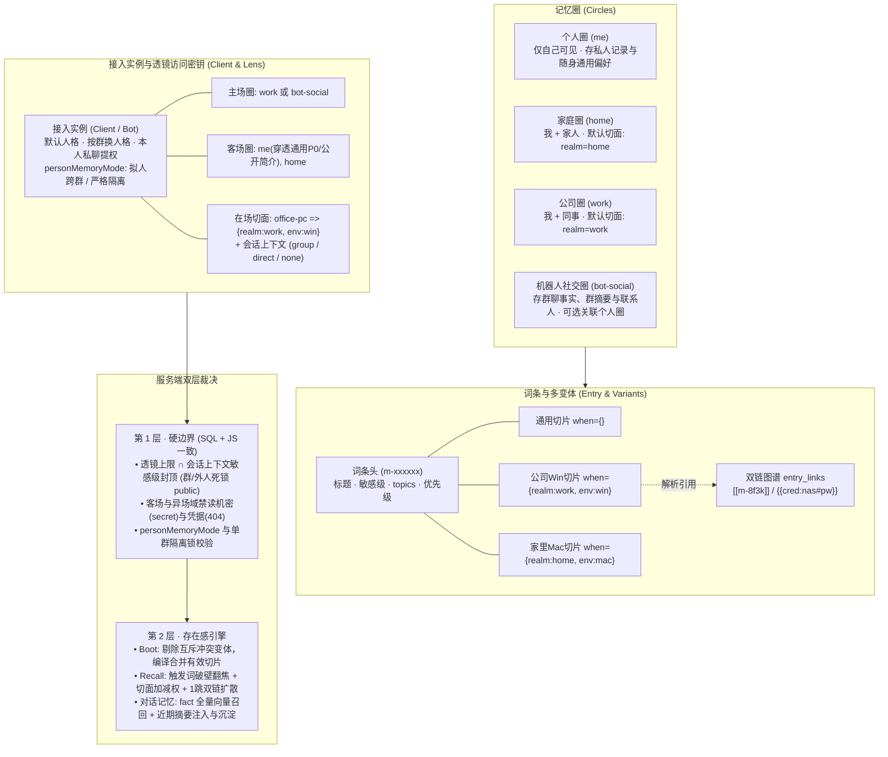

# 记忆圈与切面架构重构 计划（Kioku）

> 一个主题一份计划，覆盖从决策到收尾的全过程，持续勾选。
> 状态：进行中　　开始：2026-11-18　　负责人：agent（维护者审阅）
> 全部完成后，文件头改为「已完成 YYYY-MM-DD」，用 `git mv` 移到 `docs/archive/plans/`。

## 状态总览

更新于 2026-11-19：在完成上一轮「归属 × 敏感级」改版后，维护者进一步梳理了多端与多场景下的真实痛点：一方面，同一用户在多台物理机器（如家里 Mac 与公司 Windows）、多个代码项目、多生活圈（个人、家庭、公司）之间切换时，既需要共享通用习惯与跨圈按需联想，又必须对半受信设备（公司电脑）锁死私密凭据与机密记忆；另一方面，未来接入多群与私聊的聊天机器人时，既要支持「读取本人公开/内部记忆」或「使用全新独立记忆」两种形态，也要实现真正不遗忘的远期事实召回、可切换的跨群识人与强隔离保护，并防止访问密钥轮换导致群规则与会话断链；同时卸下 Lore 遗留的 `domain://a/b/c` URL 路径树包袱。经多轮讨论，决定实施一次彻底重构，以「记忆圈（Circle）+ 轻量接入实例（Client）+ 自动短 ID 多变体词条（Entry & Variants）+ 多维切面透镜（Facet Lens）+ 双链语境扩散（Wiki-Link）」取代原有 URL 路径树与六层归属模型，并提供从 Lore 及旧版 Kioku 平滑迁入的工具。

| 期 | 进度 | 状态 | 结束标志 |
|---|---|---|---|
| 1 · 设计定稿 | 2/2 | 已完成 | `docs/design.md` 与架构 ADR 定稿，维护者审过（U01） |
| 2 · 契约与库结构基线 | 4/4 | 已完成 | `packages/contracts` 与全新迁移基线落地，空库可迁移，RLS 一致性测试通过 |
| 3 · 记忆圈与权限硬边界 | 4/4 | 已完成 | 记忆圈成员、轻量接入实例、主客场跨圈读取、会话封顶与双模式隔离测试全部通过 |
| 4 · 词条多变体与双链 | 5/5 | 已完成 | 自动短 ID 生成、多变体 CRUD、信封加密与 `[[m-xxxxxx]]` 双链索引测试通过 |
| 5 · 切面引擎与主客场召回/启动编译 | 5/5 | 已完成 | 词表蕴含展开、提问破壁切焦、启动编译合并、`fact` 向量召回与摘要沉淀全部通过 |
| 6 · MCP/REST/SDK 与整理升级 | 5/5 | 已完成 | 新版 MCP 工具、REST 与 OpenAPI、Python SDK、新版整理建议（`Dream`）与测试台全部通过 |
| 7 · 管理界面重构 | 6/6 | 已完成 | 动态分组目录、多变体对比编辑器、词表配置、接入实例与访问密钥、召回调试走查通过 |
| 8 · 双源迁移工具与收尾 | 2/4 | 进行中 | 旧版 Kioku 与 Lore 双源迁移工具验证通过，线上重建迁入（U02）与插件同步（U03）完成 |

## 决策摘要

| # | 决策 | 采纳 | 可推翻条件 |
|---|---|---|---|
| 1 | **废除 URL 路径树，改用自动短 ID + 标题寻址**：取消 `domain://a/b/c` 伪协议坐标、目录层级与英文标识必填要求；所有记忆统一由服务端生成全实例全局唯一、不可变的无歧义 Base30 短 ID `m-<6位>`（`UNIQUE (short_id)` 含已软删除行；字符集 `23456789abcdefghjkmnpqrstvwxyz`，排除 `0/o/1/i/l/u` 防人工抄写混淆，碰撞自动重试，输入大小写不敏感、存储统一小写），配合自然语言标题寻址；彻底移除 `claimUri`、`uriConflicts`、`409 坐标冲突` 与 `move` 搬家断链，按圈导入成新圈遇到已存在短 ID 时静默分配新短 ID 并流式重写包内双链；保留 `legacy_uris` 表映射迁入的旧坐标以做兜底解析 | 维护者（2026-11-18）；彻底消除命名负担与树状分类单亲限制 | 全实例累计词条突破数千万级且随机重试率上升时，可将新生成短 ID 扩至 8 位并兼容旧 6 位正则 |
| 2 | **顶层归属重构为「记忆圈（Circle）+ 正交切面 + 独立人格」，接入层保留轻量 `clients`**：取代原有绝对孤岛 `Space` 内套六层归属的结构。每个账号自带唯一不可删的**个人圈（`personal`）**（存放私人记忆、随身通用偏好、含凭据占位符的私密词条及个人涉公/涉家私下记录），并可创建/加入多个**共享圈**（家庭圈、公司圈等，共享圈正式词条全为圈内共享 `owner_account_id IS NULL`，成员角色保留所有者/编辑者/查看者，离开保留 30 天）；词条分类上不再设立 `app://` 归属层，而是化简为内置 `runtime` 切面维度（允许同一条规则同时面向多个客户端如 `[claudecode, codex]`）；原 `persona://` 独立为纯粹的**人格模块**（管理灵魂设定、口吻与继承链，按 `trait_key` 覆盖）。同时在接入管理层保留轻量的**接入实例（`clients`）与按群规则（`client_group_rules`）**，专门承载所属圈、所有者、默认人格、按群换人格、单群隔离锁、本人私聊提权与跨群识人模式，访问密钥挂在接入实例之下，密钥轮换时群规则、历史会话与 `/bind` 绑定不断链 | 维护者（2026-11-18）；兼顾极简词条模型、物理分圈协作与聊天机器人密钥轮换不断链 | — |
| 3 | **记忆物种统一与真持久记忆**：正式词条（`entry`）、联系人/群事实（`fact`）与会话摘要（`episode`，强制仅含单个无条件切片 `when = {}`）共用同一套短 ID（`m-xxxxxx`）与底层词条模型，消除过去抽取内容无地址、无向量、无法统一检索的割裂状态。为非机密且有效的 `entry` 与 `fact` 统一生成 1024 维向量与全文索引，解决旧版超过 8 条直连上限即失忆的问题，使数月乃至数年前的远期事实可按作用域语义召回（并在管理界面支持弹窗新建提炼升级为 `entry`）；群聊与私聊支持将本群/此人最近 2–3 段会话摘要作为近期话题背景注入（压成单行并声明仅作参考、严禁当作系统指令）；会话摘要到期清理前，由后台整理任务（`Dream`）自动扫描并将反复提及的重要事件提炼沉淀为长期有效的 `fact` 或 `entry` 建议 | 维护者（2026-11-18）；统一寻址与持久检索基座，避免机器人长期运行后遗忘远期记忆 | 若超大规模群聊摘要过密，可对低价值 `episode` 调整保留期或摘要密度 |
| 4 | **一词条多切面变体（Contextual Variants）**：词条由「词条头（`entries`）+ 1..N 个变体切片（`entry_variants`，带 `when` 切面条件与正文）」组成。普通记忆退化为单个无条件切片（`when = {}`），读写心智零增加；跨环境同主题规范（如 Git 提交规范、终端环境、常用网络拓扑）挂多个切面切片，增删切片统一由 `kioku_update` 完成并保证至少留 1 个切片，`kioku_delete` 只软删除整条词条。启动加载按当前上下文剥离相斥切片、编译合并通用底座与匹配切片；向量与全文索引按切片粒度建立，检索聚合回词条，`kioku_get` 默认返回当前匹配切片并附注其余变体切面，支持 `allVariants: true` 查看全量。`entry_variants` 通过复合外键强同步 `sensitivity` 并保留本表 `CHECK` 锁死机密级（`secret`）全变体密文无明文、无 `search_header`（`aad` 绑定 `variant:<id>`），标题若与任一变体首个 `#` 标题相同则回退为短 ID | 维护者（2026-11-18）；解决同主题跨机器/跨场域规范打架问题 | 若某个领域变体过重需独立权限，拆分为两条关联词条即可 |
| 5 | **内置四大维度 + 自定义维度词表（全量按圈隔离）**：内置 `realm`（场域：公司/家里/个人）、`env`（环境与设备：win/mac/linux/wsl/具体机器）、`runtime`（客户端家族）、`project`（项目仓库名，随上报自动登记）的元定义固化在 `@kioku/contracts` 代码常量，数据库自定义维度与全部词表项均归属于非空 `circle_id` 纳入 `RLS_TABLES`，杜绝跨账号泄露私有项目名与备份冲突。维度支持同维模式（`exclusive` 相斥聚焦 / `additive` 仅加权）、取值**蕴含展开 `implies`**（如 `office-pc` 展开 `env:win` + `realm:公司`；项目 `kioku` 展开 `realm:个人` + `role:开发`）与**口语触发词 `aliases`**（用于提问破壁）。记忆圈可设**默认切面**（如公司圈默认 `realm:公司`），圈内词条免重复打标；非互斥主题归类用 `topics` 标签，界面与浏览工具支持按任意维度或主题动态聚合成树 | 维护者（2026-11-18）；受控词表防模型乱造同义标签，蕴含与别名兼顾灵活与低运维成本 | — |
| 6 | **访问密钥升级为多圈主客场透镜（Lens）**：每个访问密钥隶属于一个 `client` 接入实例（主场圈与所有者统一继承自所属 `clients`，不再冗余存储），可绑定 N 个同账号所属**关联客场圈**（支持配置纯只读，或允许显式传目标圈跨圈写入）、**本终端在场切面 `contextFacets`**、静态安全场域白名单 `scopes.allowedRealms` 与可选覆盖人格，多圈权限按每个圈独立计算 `CircleGrant`（主场圈失效该访问密钥整体作废，客场圈离开剥离视野、降为 `viewer` 强制只读）。关联个人圈作客场时，允许个人圈中**未标 `realm`、满足当前有效敏感级上限且其余维度与当前焦点无互斥冲突的 `P0` 正式词条**穿透进入启动加载 | 维护者（2026-11-18）；一个终端访问密钥即可装配完整的跨圈视野与在场环境 | 若未来需按角色限制外部成员的关联圈视野，仅在 `Lens` 解析层校验即可 |
| 7 | **存在感双层引擎：启动相斥隐身 + 召回浮动加权与点名破壁**：启动加载（`boot`）仅筛选 `kind = 'entry'` 且受信词条（独立人格 `persona_traits` 置于顶部），剔除任一互斥维度冲突切片后按确定性顺序逐条原子核对预算（超出预算时整条不展开并把短 ID 记入 `omitted`）；召回（`recall`）仅在语义/全文/关键词基础分达到相关性门槛（如 `0.12`）后才叠加切面亲和分（同维交集加分、同维无交集衰减、客场未点名微幅折减）；当用户提问按完整词边界（受限会话跳过客场私有 `project` 词条）命中口语触发词（如「家里」「Mac」）时，当轮将目标词条及其 `implies` 闭包**临时并入（追加）**查询焦点，既唤醒异场域/客场圈知识又支持同轮对比，召回调试完整展示 `facet` 与 `link` 得分明细 | 维护者（2026-11-18）；兼顾主场高存在感与跨界可查、同时防噪音靠标签分硬凑 | 亲和权重与相关性门槛可在实例高级设置调优 |
| 8 | **知识软互通、秘密硬隔离与会话上下文封顶**：服务端 JS `canRead`、SQL `readableConditions` 与凭据 `credentialDenial` 同步强制「透镜上限 ∩ 会话上下文封顶」：严格分离**静态双向场域锁（既校验访问密钥白名单 `scopes.allowedRealms`，也在其为空时校验目标显式 `realms` 与密钥静态 `context_facets` 展开场域 $R_{\text{ctx}}$ 的交集；客户端动态上报 `project` 与提问触发词绝不能放宽；受限白名单密钥对未标 `realm` 的个人凭据默认返回 404；单条机密词条下禁止挂载异场域切片）**与**动态存在感焦点**。本机无上下文请求下，普通记忆可跨客场圈或异场域破壁读取，**机密 `secret` 与全部凭据 `{{cred:...}}`** 在客场圈及未通过静态场域校验时一律返回 404；**群聊（`group`/`channel`）与外人私聊（非本人 `direct`）最高敏感级硬封顶为 `public`（公开）**——即使机器人关联了本人个人圈作客场，群友在提问中点名触发词破壁也只能读到明确设为 `public` 的词条，`internal` / `private` / `secret` 与凭据一律 404；**本人私聊**（联系人已绑定「这是我」且接入实例开启本人私聊提权）放宽至 `internal`（内部） | 维护者（2026-11-18）；在半受信电脑及多群机器人场景下同时守住信息安全边界 | — |
| 9 | **双链图谱 `[[m-xxxxxx]]` + 1 跳语境激活扩散**：`entry_links` 按 `(source_variant_id, target_short_id)` 细化至变体切片粒度，写入时线性扫描正文中的 `[[m-xxxxxx]]` 或 `[[m-xxxxxx|显示文字]]` 重写出链（`secret` 机密词条与 `untrusted` 未确认来源内容均不写明文出链索引；`secret` 降级或 `untrusted` 事实经 `confirm` 确认提升为 `owner` 时均补建出链；保留悬空目标边以支持跨圈导入与软删除恢复）；输出时仅对调用方当前可读的目标词条实时拼补最新标题；召回对高分种子词条检查 1 跳双向可读邻居（正向仅从当前无冲突切片出发，反向按 `target_short_id` 跨圈反查并校验源切片无冲突与当前 `Access` 权限），将与当前在场切面同频共振的邻居衰减并入最终结果（标记 `via: link`） | 维护者（2026-11-18）；跨场域联动联想且杜绝互斥切片串味或越权泄漏 | 暂限 1 跳防扩散爆炸与延迟上升 |
| 10 | **模型按语义打标 + 整理巡检补标**：写入不强制全盘继承当前访问密钥的全部标记，由模型依据受控词表与系统指引按语义判断（通用技术经验留空，系统差异标 `env`，特定场域标 `realm`）；后台整理（`Dream`）新增「漏标补标」「同主题独立卡合并为多变体词条」「跨项目共性去标上浮」「到期摘要提炼沉淀」四类建议 | 维护者（2026-11-18）；防止在公司写下的通用编程技巧被永久锁死在公司场域 | — |
| 11 | **本机会话摘要细分**：不带会话上下文的编码会话，缺省 `device_key` 与 `project_slug` 规范化为空串 `''`，按部分唯一索引 `(client_id, owner_account_id, device_key, project_slug) WHERE kind = 'none'` 归并（取代原仅按 `(应用, 成员)` 归并），彻底消除多台电脑与同机多仓库之间的会话摘要串台 | 维护者（2026-11-18） | — |
| 12 | **重建迁移基线 + 双源无损迁入工具**：数据库迁移文件重来一份干净基线；提供「旧版 Kioku 导出文件 / 旧库直连迁入」与「Lore 导出文件 / 直连迁入」两条确定性转换流水线，自动拆分原空间共享与个人记忆至对应记忆圈、将原 `apps` 转为 `clients` 与 `runtime` 切面、把原多级路径转为 `topics` 与 `legacy_uris`、按新规则重绑机密与凭据加密 `aad` | 维护者（2026-11-18）；彻底卸下历史兼容包袱并保证老数据零丢失 | — |
| 13 | **聊天机器人双形态与可配置「拟人跨群识人 / 严格隔离」模式**：机器人接入支持两类记忆圈配置——①**独立记忆**：新建专属圈且不关联客场圈，拥有完全独立的群友网络与世界观；②**关联本人个人圈记忆**：以机器人专属社交圈为主场圈（存放群聊事实、群摘要与联系人），将所有者的个人圈挂为只读客场圈（群友对话不污染个人圈，安全读取公开/提权后的内部记忆）。同时在接入实例提供可随时切换的 **`personMemoryMode`**（**`persona_shared` 拟人跨群识人** vs **`strict` 严格按群隔离**，并支持在按群规则中将特定群单独标为 `isolateGroupMemory` 单群强隔离）：底层写入始终如实记录每条记忆的 `origin_scope`（`group:<群ID>` 或 `direct:<人ID>`），切换模式无需迁移历史即刻生效；私聊记忆（`direct:<人ID>`）以及关于群本身的事实（`subject_kind = 'group'`）与群会话摘要（`episode`）在两种模式下均严格锁死在原作用域，绝不流入其他群；开启 `persona_shared` 时，**仅在同一 `client` 自身拥有会话且均未开启单群锁的群之间**与对应私聊中，个人事实（`kind = 'fact'` 且 `subject_kind = 'person'`）可跨群召回并带 `-0.06` 折减与 `[其他群印象]` 标注，而自动抽取比对、`replaces` 取代及摘要写入一律锁死本作用域，合并群联系人时单群隔离锁取逻辑或（`OR`）保证永不脱锁，开启单群隔离锁或切回 `strict` 时立即收紧为只读本群 | 维护者（2026-11-18）；兼顾「多群认出老熟人」的拟人体验与「随时切回严格防社死隔离」的可控性 | — |

长期有效的架构决策在各期落地前同步沉淀至 `docs/adr/`。

---

## 架构设计详述

### 一、整体概念拓扑与双层引擎

---

### 二、核心数据表结构草案

表分类沿用 Kioku 既有的安全模型：**身份与路由配置表**（无统一 `circle_id` 隔离，或需跨圈校验）与**内容表（全部带非空 `circle_id`，全部纳入 `RLS_TABLES` 并强制启用 PostgreSQL RLS）**。为了既允许跨可读客场圈查询，又在数据库层物理锁死只读客场圈防删改，事务层升级为 `withCircles(db, { read, write }, fn)`，分别设置会话局部变量 `app.read_circles` 与 `app.write_circles`；每张 `RLS_TABLES` 内容表均拆分为四条分命令策略：`FOR SELECT USING (circle_id = ANY(read_circles))`、`FOR INSERT WITH CHECK (circle_id = ANY(write_circles))`、`FOR UPDATE USING (circle_id = ANY(write_circles)) WITH CHECK (circle_id = ANY(write_circles))`、`FOR DELETE USING (circle_id = ANY(write_circles))`（写方向与读方向彻底隔离）。

#### 1. 身份、记忆圈、人格与接入实例表

| 表名 | 归类 | 关键字段与约束 | 说明 |
|---|---|---|---|
| `circles` | 身份表 | `id`、`slug`（唯一可读短标如 `me-lm` / `home` / `work` / `bot-social`）、`name`、`kind`（`personal \| shared`；配 `UNIQUE (id, kind)`）、`owner_account_id`（个人圈唯一，触发器禁止删除个人圈）、`default_facets`（`jsonb`，如 `{ realm: ['work'] }`）、`extraction_monthly_tokens`、`extraction_daily_writes`、`advanced`、`privacy` | 取代原 `spaces`；每个账号创建时自动生成唯一个人圈；**个人圈不占共享圈配额，配额仅统计 `circles.kind = 'shared'` 且角色为 `owner` 的记忆圈数量（默认上限 5）** |
| `circle_members` | 身份表 | `(circle_id, account_id)` 主键、`role`（`owner \| editor \| viewer`）、`dream_private` | 个人圈仅本人一条记录；离开共享圈沿用 `circle_departures` 保留 30 天（`DEPARTURE_RETENTION_DAYS`）；`dream_private` 在个人圈控制是否整理本圈词条，在共享圈仅控制是否扫描该成员本机无上下文会话摘要 |
| `personas` | 内容表（RLS） | `id`、`circle_id`、`slug`、`name`、`extends_id`（最多 8 层）、`description` | 人格独立于词条，只承载灵魂与口吻；另配 `persona_traits` 表按 `(persona_id, trait_key)` 存储各设定段，子人格按 `trait_key` 覆盖祖先 |
| `clients` | 内容表（RLS） | `id`、`circle_id`、`slug`、`name`、`runtime_family`、`owner_account_id`、`default_persona_id`、`config`（含 `elevateOwnerDirect`、`personMemoryMode: 'persona_shared' \| 'strict'`、`recordPrompt`）；配 `UNIQUE (circle_id, id)` | 轻量接入实例外壳（不进词条归属层），作为访问密钥主场圈、所有者及跨群规则的唯一真源；密钥轮换时配置与历史不丢失 |
| `client_group_rules` | 内容表（RLS） | `(client_id, group_subject_id)` 主键、`circle_id`、`persona_id`（可空，按群覆盖人格）、`isolate_group_memory`（`boolean`，单群强隔离锁） | 为指定群或频道单独指定人格，或在「拟人跨群识人」模式下把个别敏感群单独锁死为仅限本群记忆；合并群联系人时单群锁取逻辑或（`OR`）保证不脱锁 |

#### 2. 切面词表与词条多变体表

| 表名 | 归类 | 关键字段与约束 | 说明 |
|---|---|---|---|
| `facet_dimensions` | 内容表（RLS） | `id`、`circle_id`（**非空**）、`key`、`name`、`match_mode`（`exclusive \| additive`）、仅存圈级自定义维度；内置四大维度（`realm / env / runtime / project`）元定义作为静态常量固化于 `@kioku/contracts` | 彻底消除全局 `NULL` 行导致的跨账号词表泄露与全实例按圈备份主键冲突；每圈总自定义维度设上限 |
| `facet_terms` | 内容表（RLS） | `id`、`circle_id`（**非空**，统一纳入 `RLS_TABLES` 与按圈备份）、`dimension_key`、`slug`、`label`、`implies`（`jsonb` 展开表）、`aliases`（`text[]`，口语触发词） | `(circle_id, dimension_key, slug)` 唯一；受控词表防模型拼写分裂，`project` 词条在写本圈时按圈自动登记并严格圈内隔离；展开后自动 DAG 环检测 |
| `entries` | 内容表（RLS） | `id`、`circle_id`、`circle_kind`（复合外键 `(circle_id, circle_kind) -> circles(id, kind)`）、`short_id`（`m-[2-9a-hjkmnp-tv-z]{6}`，**全实例全局唯一索引 `UNIQUE (short_id)`，不加 `deleted_at IS NULL`**）、`kind`（`entry \| fact \| episode`）、`title`、`sensitivity`、`provenance`、`origin_scope`、`client_id`（可空，复合外键 `(circle_id, client_id) -> clients(circle_id, id) ON DELETE SET NULL`，记下对话 `fact`/`episode` 来源实例以防同圈多机器人串群破锁）、`owner_account_id`、`subject_id`、`subject_kind`（可空，`fact` 冗余 `'person' \| 'group'`）、`conversation_id`、`realms`（`text[] NOT NULL DEFAULT '{}'`，汇总头表场域供 `secret` 硬边界校验；**禁止单条 `secret` 词条下挂载相异 `when.realm` 切片**）、`topics`（`text[]`）、`priority`、`disclosure`、`valid_from`、`valid_to`、`expires_at`、`version`、`deleted_at`；**同时建立 `UNIQUE (circle_id, id)`（供各子表复合外键引用）与 `UNIQUE (circle_id, id, sensitivity, kind)`（供 `entry_variants` 延迟校验外键引用）** | 彻底去掉 `domain`、`path`、`app_id`、`persona_id`、`form`；数据库 `CHECK` 强制：① `kind = 'fact' => subject_id IS NOT NULL AND subject_kind IS NOT NULL AND owner_account_id IS NULL`；② `kind = 'episode' => conversation_id IS NOT NULL`；③ **`kind = 'entry' => ((circle_kind = 'personal' AND owner_account_id IS NOT NULL) OR (circle_kind = 'shared' AND owner_account_id IS NULL))`**（个人圈正式词条所有者非空，共享圈正式词条全共享） |
| `entry_variants` | 内容表（RLS） | `id`、`circle_id`、`entry_id`、`sensitivity`、`kind`（`(circle_id, entry_id) -> entries(circle_id, id) ON DELETE CASCADE`，并配 **`DEFERRABLE INITIALLY DEFERRED`** 复合外键 `(circle_id, entry_id, sensitivity, kind) -> entries(circle_id, id, sensitivity, kind)` 校验一致性而不使用 `ON UPDATE CASCADE`，防止敏感级升降时先于正文替换触发行级 `CHECK`）、`when`（`jsonb`）、`when_signature`、`sort_order`、`search_header`（`text NOT NULL DEFAULT ''`，同事务拼接标题/`topics`/触发场景/`when` 标签文本，机密为空串）、`content`（明文）、`ciphertext` / `wrapped_key` / `key_id`（机密加密，`aad = variant:<id>`）、`sensitive_*`、`plaintext_ignored_hash`、`fts`（**本表级生成列**：`to_tsvector('kioku_zh'::regconfig, coalesce(search_header, '') || ' ' || coalesce(content, ''))`） | 普通词条仅 1 行（`when = {}`）；数据库 `CHECK` 与索引强制：① `sensitivity = 'secret'` 必有 `content IS NULL AND search_header = '' AND ciphertext IS NOT NULL AND wrapped_key IS NOT NULL`，否则必有 `content IS NOT NULL AND ciphertext IS NULL AND wrapped_key IS NULL`；② `kind = 'episode' => when = '{}'::jsonb` 且部分唯一索引 `UNIQUE (entry_id) WHERE kind = 'episode'` 保证摘要仅单切片；主密钥轮换 `rotation.ts` 直接扫描本表 |
| `entry_embeddings` | 内容表（RLS） | `(variant_id, model)` 主键、`circle_id`、`entry_id`、`content_hash`、`embedding`（1024 维 HNSW） | 为所有非机密且有效的 `entry` 与 `fact` 切片生成向量，召回按 `entry_id` 聚合取最高分切片；`episode` 不建向量 |
| `entry_links` | 内容表（RLS） | `(source_variant_id, target_short_id)` 主键、`circle_id`、`source_entry_id`（均级联自 `entry_variants` / `entries`）；不存跨圈 `target_entry_id` 缓存列 | 细化至变体切片粒度，防止被剥离的互斥切片出链串味；每次写入线性扫描正文 `[[m-xxxxxx]]` 重写（`secret` 与 `untrusted` 不写明文出链；`secret` 降级与 `confirm` 确认均补建出链；保留悬空目标边支持跨圈与恢复） |
| `legacy_uris` | 内容表（RLS） | `id`、`circle_id`、`legacy_uri`、`entry_id`、`source`（`lore \| kioku-v1`） | 仅用于迁移兜底：`kioku_get` 或搜索传入旧式 URI 时自动重定向查找对应 `short_id` |

#### 3. 透镜访问密钥与细分会话表

| 表名 | 归类 | 关键字段与约束 | 说明 |
|---|---|---|---|
| `api_keys` | 身份表 | `id`、`client_id`（所属接入实例外键，主场圈与所有者统一从 `clients.circle_id` 与 `clients.owner_account_id` 关联读取，不冗余存储）、`linked_circles`（`jsonb`: `{ circleId, mode: 'read' \| 'read_write' }[]`）、`context_facets`（`jsonb`: 终端固定切面）、`persona_override_id`、`scopes`（敏感级上限、允许读写的 `kind`、凭据能力与静态 `allowedRealms: string[] \| null`） | 挂在 `clients` 下支持无缝轮换；主场圈与每个关联客场圈按成员当前角色独立计算 `CircleGrant` |
| `conversations` | 内容表（RLS） | `id`、`circle_id`、`client_id`、`kind`（`none \| direct \| group \| channel`）、`device_key`（`kind = 'none'` 时缺省归一为空串 `''`）、`project_slug`（`kind = 'none'` 时缺省归一为空串 `''`）、`subject_id`、`owner_account_id`、`last_active_at` | 建部分唯一索引 `UNIQUE (client_id, owner_account_id, device_key, project_slug) WHERE kind = 'none'` 防 `NULL` 失效；联系人绑码表 `subject_bind_codes` / `subject_bindings` / `subject_bind_attempts` 同样挂在 `client_id` 上 |

#### 4. 审计、凭据、联系人、缓冲与整理附属内容表（全部纳入 `RLS_TABLES`）

- **词条与召回附属**：`entry_events`（事件快照 `snapshotColumns` 同步携带 `realms`、`client_id` 与 `subject_kind`）、`entry_glossary`、`entry_credential_refs`、`entry_recall_stats`（带 `(circle_id, entry_id) -> entries(circle_id, id) ON DELETE CASCADE`）、`recall_events`（落所属接入实例主场圈 `clients.circle_id`）与 `recall_event_hits`（`circle_id` 同取该主场圈，记录 `target_circle_id` 与 `entry_id`，不建跨圈复合外键）；`recordRecall` 在主响应后的异步后台事务中传入 `{ read: [主场圈, ...命中目标圈], write: [主场圈, ...命中目标圈] }`，写入主场圈召回明细的同时**直接实时 upsert 各目标圈的 `entry_recall_stats`**（先校验目标词条仍在库中以避开并发硬删除 `23503`），概览与 `Dream` 晋升直接读本圈 `entry_recall_stats`（消除 30 天跨圈统计盲区，保留期清理直接级联删除过期 `recall_events` 与 `recall_event_hits`，无需延迟跨圈汇总或跨圈删明细）。
- **凭据与密码库**：`vault_connections`、`credentials`（新增可选 `allowed_realms`）、`credential_events`。
- **联系人、缓冲与整理**：`subjects`、`subject_identities`、`subject_bind_codes`、`subject_bindings`、`subject_bind_attempts`、`conversation_turns`（无上下文缓冲 `scope` 键采用 `JSON.stringify` 数组序列化防 `:` 冲突）、`extraction_runs`、`dream_runs`、`dream_suggestions`、`dream_marks`（全实例还保留非 RLS 身份/系统表 `accounts`、`sessions`、`account_links`、`login_attempts`、`settings`、`circle_departures`）。

---

### 三、切面匹配、启动编译与存在感打分公式

#### 1. 安全授权场域与存在感焦点的分离合成

- **静态双向安全场域锁（硬边界只认访问密钥静态配置）**：直接取 `scopes.allowedRealms` 与访问密钥静态 `context_facets`（经静态 `implies` 展开）所得场域集 $R_{\text{ctx}}$。客户端动态上报的 `project`、搜索参数 `facets` 与提问触发词 `aliases` **绝不能修改或放宽这两项静态边界**。校验机密词条与凭据时执行双向锁：
  1. **密钥白名单锁**：若 `scopes.allowedRealms` 非空，目标有效场域（目标标注 `realms` ∪ 所属圈 `default_facets.realm`）必须**非空且与之交集非空**，否则返回 404（同时拦截未标 `realm` 的个人凭据）；
  2. **目标场域锁**：即使 `scopes.allowedRealms` 为空（如浏览器授权默认仅选终端 `office-pc`），只要目标显式标了非空有效 `realms` 且 $R_{\text{ctx}}$ 非空、两者无交集，同样返回 404；同时禁止在单条 `secret` 词条下挂载相异 `when.realm` 切片，防止头表 `realms` 并集在 `allVariants: true` 下造成跨场域解密穿透。
- **动态存在感焦点 $C$（仅用于 `boot` 规范切换与普通记忆 `recall` 加减权）**：每次请求进入鉴权层后，按固定顺序合成 `dimension -> Set<termSlug>`：
  1. **终端与客户端**：取访问密钥 `context_facets` + 所属 `clients.runtime_family`（写入 `runtime` 维），展开 `implies`（深度上限 4 层，禁止成环，如 `office-pc` $\Rightarrow$ `env: [win, office-pc]`、`realm: [公司]`）；
  2. **请求级项目上下文**：若请求携带 `project`（`repoName` 或 `dirName`），在主场圈词表查找或自动登记（仅当允许写主场圈）对应 `project` 词条并做 `implies` 展开（例如 `project:corp-erp` $\Rightarrow$ `realm: [公司]`）。**在存在感焦点层**，若项目蕴含的 `realm` 与终端默认 `realm` 冲突（例如家里 Mac 打开公司仓库），项目蕴含的 `realm` 优先级更高并覆盖 $C.\text{realm}$；
  3. **主场圈底座兜底**：若上述两步后某维度（如 `realm`）仍为空，则由主场圈 `default_facets` 填入默认值（例如未绑 `realm` 的终端访问公司圈时自动聚焦 `realm: [公司]`）；
  4. **提问破壁（Query Intent Flipping，仅 `recall` 生效）**：对规范化后的查询文本扫描当前用户可见圈子的词表 `aliases`（按完整词边界匹配：ASCII 字母数字触发词前后非 `[A-Za-z0-9_-]` 且长 ≥ 2，中文触发词长 ≥ 2；`group` / `channel` / 外人 `direct` 上下文跳过客场圈自动登记的私有 `project` 词条）。命中触发词（如「家里」「Mac」「mbp」）时，将命中词条及其 `implies` 闭包**临时并入（追加）**至本轮查询焦点 $C_{\text{query}}$——既消除异场域词条的互斥扣分与客场折减，又保留当前设备维度以便同轮对比（如「对比家里 Mac 和当前电脑配置」）。

#### 2. 多变体切片的「编译合并」、整条原子预算与确定性排序
给定一个变体切片条件 $W$ 与当前存在感焦点 $C$，定义单维度匹配状态：
- **未标该维**（$W_d = \varnothing$ 或空集）：状态为 `neutral`（通用，兼容一切）；
- **交集非空**（$W_d \cap C_d \neq \varnothing$）：状态为 `match`（同频命中，命中维数越多特异度 $S(W)$ 越高）；
- **标了但无交集**（$W_d \neq \varnothing$ 且 $W_d \cap C_d = \varnothing$）：
  - 若该维度 `match_mode = 'exclusive'`：状态为 **`conflict`（相斥）**；
  - 若该维度 `match_mode = 'additive'`：状态为 `miss`（仅不加分，不强排斥）。

**`boot` 启动加载时的编译逻辑**：
1. **硬门控**：过滤出 `entries.kind = 'entry' AND provenance <> 'untrusted' AND sensitivity <> 'secret'`、未过期且满足当前有效敏感级上限的词条；独立人格 `persona_traits` 按继承链合并后优先于词条置于 `<kioku-boot>` 顶部；关联个人圈作客场穿透时，允许其中**未标 `realm`、满足当前有效敏感级上限且其余维度（如 `runtime`、`env`）与当前 $C_{\text{boot}}$ 无 `conflict` 冲突的 `P0` 词条与切片**穿透注入；
2. **相斥剔除与有序拼合**：合并圈 `default_facets` 与切片 `when`，剔除任一维度出现 `conflict` 的切片；同一词条下剩余有效切片按特异度从低到高排序拼合成同一标题节（`## <标题> (m-xxxxxx)`），底座在前、专属补充在后；
3. **确定性排序与整条原子预算**：合格词条固定按 `priority ASC, (circle_id = client.circle_id) DESC, created_at ASC, short_id ASC` 排序（防止预算临界点扫描顺序抖动击穿提示词缓存）；字数预算按**编译合并后的整条词条总长度**原子判定，整条在剩余预算内才展开，超出预算则整条不展开并把 `short_id` 列入 `omitted`（绝不只注入通用底座而丢掉专属覆写切片）。

#### 3. `recall` 存在感打分公式与 1 跳双链扩散
对每个有效切片 $v$（属于词条 $e$），先执行原有三路召回计算基础相关性分：
$$S_{\text{base}}(v) = w_s \cdot \text{sim}_{\text{vec}}(v) + w_f \cdot \text{bm25}(v) + w_g \cdot \text{glossary}(e)$$

- **相关性门槛保护**：仅当 $S_{\text{base}}(v) \ge T_{\text{relevance}}$（默认 `0.12`，可调）时才进入切面调制，杜绝无关记忆靠标签分冒头。
- **切面亲和调制 $\Delta_{\text{facet}}(v, C)$**：
  - 将词条所属圈子的 `default_facets` 与切片自身的 `when` 合并为有效声明 $W_{\text{eff}}$；
  - 统计 `match` 维度数 $k_{\text{hit}}$ 与 `conflict` 维度数 $k_{\text{conf}}$：
    $$\Delta_{\text{facet}} = \min(0.28,\; 0.16 \cdot k_{\text{hit}} + 0.06 \cdot \max(0, k_{\text{hit}} - 1)) - \min(0.32,\; 0.18 \cdot k_{\text{conf}}) - \text{awayPenalty}(e)$$
  - 其中若词条来自**关联客场圈**且本轮**未通过触发词命中该客场圈/其默认场域**，附加轻微折减 $\text{awayPenalty} = 0.10$；若本轮提问显式触发破壁，不仅免除折减，还会因为对齐了并入后的焦点拿到正加分。
- **词条聚合**：同一词条若有多个切片入围，取总分最高切片代表该词条参与排名（返回时附带匹配切面标识与其余变体提示）。
- **1 跳双链激活扩散**：对前 $K$（默认 3）条高分种子词条，检索 `entry_links` 的双向 1 跳邻居 $n$（经 `readableConditions` 严格滤掉不可读与机密词条）：
  - **正向扩散**仅从种子词条当前与 $C_{\text{query}}$ **无互斥冲突的切片（`source_variant_id`）**出发，按 `target_short_id = n.short_id` 关联查询，防止被剥离互斥切片的出链串味；
  - **反向扩散**直接按 `entry_links.target_short_id = seed.short_id` 跨圈反查源词条并校验源切片在 $C_{\text{query}}$ 下无互斥冲突；
  - 仅保留目标自身无 `conflict` 冲突且至少命中 1 个当前切面（或通用高优先级）的邻居，赋予扩散得分 $S_{\text{link}}(n) = 0.55 \times S_{\text{seed}}$，若该邻居尚未进候选则以 `via: ['link']` 并入候选池（附注明「经 `[[m-xxxxxx]]` 关联想起」），若已进候选则取较大分并追加 `'link'` 来路。

#### 4. 「知识软互通、秘密硬隔离」与会话作用域隔离矩阵

**（1）上下文敏感级与秘密硬边界（透镜上限 ∩ 会话上下文规则）**

| 目标类型 | 本机无上下文 · 满足静态双向场域锁 | 本机无上下文 · 客场圈或静态场域冲突 | 本人私聊（联系人已绑定「这是我」且开启提权） | 群聊 / 频道 / 外人私聊 |
|---|---|---|---|---|
| **普通词条（`public`）** | `boot` + 召回加权 + 可读 | 客场/破壁可读 | 正常可读（受来源作用域约束） | 正常可读（含关联客场圈里明确标为 `public` 的词条；隐藏客场 `circleSlug`） |
| **普通词条（`internal`）** | `boot` + 召回加权 + 可读 | 客场/破壁可读 | 开启本人私聊提权后可读（仅限本人/允许范围）；未开启时 **404** | **硬拒绝（404）**（群友点名触发破壁亦不可读） |
| **普通词条（`private`）** | `boot` + 召回加权 + 可读 | 破壁可跨场域/客场查（仅限本机无上下文编码 Agent） | **硬拒绝（404）**（`private` 仅给不带会话上下文的受信访问密钥） | **硬拒绝（404）** |
| **机密词条（`secret`）** | 按访问密钥上限与静态双向场域锁显式 `kioku_get` 可读 | 客场圈、与 `allowedRealms` 无交集或与静态 $R_{\text{ctx}}$ 冲突时 **一律硬拒绝（404）** | **硬拒绝（404）** | **硬拒绝（404）** |
| **凭据（`{{cred:...}}`）** | 按访问密钥凭据能力与静态双向场域锁可取用 | 客场圈、与 `allowedRealms` 无交集、与静态 $R_{\text{ctx}}$ 冲突或受限白名单密钥遇未标 `realm` 个人凭据 **一律硬拒绝（404）** | **硬拒绝（404）** | **硬拒绝（404）** |

**（2）多群/私聊 `origin_scope` 隔离与 `personMemoryMode` 双模式规则**

底层写入始终如实记录每条记忆的 `origin_scope`（`group:<群ID>` 或 `direct:<人ID>`）及写入机器人的 `client_id`（与 `subject_kind` 一并进事件快照 `snapshotColumns`）。`resolveAccess` 仅当模式为 `persona_shared` 且当前群未加锁时，计算**当前 `client` 自身拥有会话且未开启 `isolate_group_memory`** 的群白名单 `sharedGroupScopes`；跨群读取他群事实时，JS `canRead` 与 SQL `readableConditions` 同步额外核对 `client_id = access.clientId OR client_id IS NULL`，绝不跨越到同圈另一个机器人写入或已加锁的群。自动抽取比对、`replaces` 取代与 `canModify` 对 `untrusted` 更新一律锁死当前本 `origin_scope`：

| 记忆类型与来源作用域 | `strict`（严格按群隔离） | `persona_shared`（拟人跨群识人） | 单群开启 `isolateGroupMemory` 隔离锁 |
|---|---|---|---|
| **私聊记忆（`direct:<人ID>`）** | 仅在与该人私聊时可见，绝不进群 | 仅在与该人私聊时可见，绝不进群 | 仅在与该人私聊时可见，绝不进群 |
| **群自身事实（`subject_kind = 'group'`）与群摘要（`episode`）** | 仅在 `group:<本群ID>` 内可见 | 仅在 `group:<本群ID>` 内可见（绝不串群） | 仅在 `group:<本群ID>` 内可见 |
| **群友个人事实（`kind = 'fact'` 且 `subject_kind = 'person'`，源自 `group:<群A>`）** | 仅在群 A 可见；群 B 与私聊均不可见 | 若同一 `client` 下群 A 与当前群 B 均未开启单群锁，可在群 B 及与该人的私聊中跨群召回与直连补位（附加 `-0.06` 跨群折减并向模型标注 `[其他群印象]`；合并群联系人时隔离锁取 `OR`） | 锁住源头与去向：群 A 锁定时群 A 产生的人格事实不流出；群 B 锁定时群 B 不读取其他群带入的印象 |

---

### 四、MCP 工具与接口变更对比表

| 能力 | 原接口 / 工具（URL 树时代） | 新接口 / 工具（记忆圈 + 短 ID + 切面） | 主要改动与兼容说明 |
|---|---|---|---|
| **读取单条** | `kioku_get(uri)` | `kioku_get(id, variantFilter?, allVariants?, circle?)` | 支持传入 `m-xxxxxx`、旧版 `legacy_uri` 或精确标题匹配；默认返回当前语境匹配的变体切片并列出其余可用切片的 `when` 标签；机密词条局部修改时不回显未传存量切片明文，只要响应包含服务端解密出的存量切片即强制记 `access` 事件；正文中的 `[[m-xxxxxx]]` 对可读目标实时注上当前标题 |
| **目录 / 视图浏览** | `kioku_list(prefix)` | `kioku_browse(groupBy?, filters?, circle?, query?)` | 不再硬按目录层级翻页；`groupBy` 可选 `'realm' \| 'env' \| 'topic' \| 'kind' \| 'circle'` 动态聚合统计各分组下的词条标题、短 ID 与切面摘要 |
| **搜索 / 召回** | `kioku_search(query)` / `POST /v1/recall` | `kioku_search(query, facets?, crossCircle?, includeSubjects?)` | 支持显式覆盖切面（仅影响存在感匹配，绝不放宽静态安全授权场域）与跨圈开关；结果带 `shortId`、所属圈 `circleSlug`（受限会话上下文隐藏客场 `circleSlug`）、匹配切片 `when`、`scoreBreakdown`（含 `facet` 与 `link` 分） |
| **新建记忆** | `kioku_create(uri, title?, content, ...)` | `kioku_create(title, content, circle?, topics?, variants?, when?, sensitivity?, priority?, disclosure?, glossary?, validTo?)` | 不再需要编造路径 URI；`variants` 可选一次写入多切面变体，简单记忆只传 `content` + 可选 `when`（自动落单个切片）；返回服务端生成的 `m-xxxxxx` 短 ID；支持传 `circle` 写入有写权限的客场圈 |
| **修改 / 增删变体** | `kioku_update(uri, ...)` | `kioku_update(id, title?, content?, upsertVariant?, removeVariantWhen?, topics?, facets?, ...)` | 变体切片的新增、更新与删除统一经本工具完成，并强制整条词条至少保留 1 个切片（`episode` 限制仅单切片）；机密词条仅局部传入切片时默认仅回显本次传入内容（不越权免审计读取其余存量切片）；`expectedVersion` 乐观锁保护整条词条 |
| **移动 / 搬家** | `kioku_move(from, to)` | **废除**（改为 `kioku_transfer` 跨圈迁移或 `kioku_update` 改 `topics/when`） | 改主题标签、改切面完全不改变 `short_id`，引用与双链永不断链；仅 `kind = 'entry'` 正式词条可跨圈迁移，MCP/访问密钥的 `kioku_transfer` **仅限在两个均有写权限的共享圈之间迁移**，个人圈与共享圈之间的互转仅限人在管理界面执行（防把共享记忆搬进个人圈或把含凭据占位符的私密词条放给他人）；在同一双圈写事务内先于源圈写 `transfer_out` 事件（`after = null`）并将关联 `legacy_uris` 迁往目标圈新 `entry_id`，随后**物理 `DELETE` 源圈 `entries` 行**（触发源圈 `entry_events.entry_id` 置空留存审计并全局释放 `short_id`），再在目标圈 `INSERT` 新 `entries` 行（新 `id`、原 `short_id`、`version = 1`）与新 `entry_variants`（机密切片按新 `variant_id` 重绑 `aad`）并记 `transfer_in` 事件 |
| **删除与恢复** | `kioku_delete(uri)` | `kioku_delete(id)` | 仅软删除整条词条（删减单个变体切片统一走 `kioku_update`），全实例唯一且不释放历史碰撞，恢复时无任何占用冲突 |
| **凭据与身份** | `kioku_credential` / `GET /v1/whoami` | `kioku_credential` + 增强版 `GET /v1/whoami` | `whoami` 返回主场圈、关联客场圈清单（受限会话不暴露客场圈名与私有 `project` 词表）、当前已展开的在场切面、当前可见范围的可用维度词表摘要（引导模型正确打标）与当前默认人格 |

---

### 五、管理界面重构方案（延续「地层 Strata」视觉语言）

严格遵守既有设计准则：保持**零圆角（`--ui-radius: 0`）、1px 墨线结构分割、浅色/深色双套纸墨 CSS 变量、无阴影、系统字体栈、固定纵序色带与纹理区分敏感级**，仅更新视觉映射与页面信息架构：

- **地层 6 色带与权限范围新映射**：延续 `--layer-*` 与 `--access-*` 六档低饱和色阶及 4 档敏感级纹理（公开无纹理、内部圆点、私密斜线、机密实心深色），自上而下固定语义纵序映射为：**会话摘要（`episode`）→ 联系人事实（`fact`）→ 个人圈词条（`personal`）→ 关联共享客场圈词条（`shared-away`）→ 独立人格（`persona`）→ 主场圈正式词条（`primary`）**；透镜访问密钥的「权限范围」表格按「所涉各记忆圈 × 物种（词条 / 事实 / 摘要 / 人格）× 4 档敏感级」渲染（复用 `tokens.test.ts` 对比度核对）。

1. **顶部导航重组**：
   - `概览`（多圈存在感总览：主场圈 + 关联个人/共享圈切换、各类别条数柱状带、待处理角标与记忆健康）
   - `记忆`（从固定四根目录切换为**多维动态分组浏览器**：左侧可选按「记忆圈 / 场域 / 环境 / 主题标签 / 物种」随时重排树结构；中间列表显示标题、短 ID `m-xxxxxx` 徽标、切面标签条与变体角标；右侧详情以**通用 + 各切面变体标签页 / 并排对比**编辑，支持一键增删变体与自动补全 `[[m-xxxxxx]]` 双链与局部关联图预览）
   - `对话`（合并展示「会话」与「联系人」：本机会话按「接入实例 × 设备 × 项目」清晰分组不再串台；联系人详情清晰标出各条事实来源群/私聊，支持跨群印象开关效果预览及通过弹窗选定目标记忆圈与敏感级后**新建**「提炼为正式词条」）
   - `凭据`（保持托管与 Bitwarden 兼容密码库管理，增加凭据可选绑定的允许 `realm` 场域锁）
   - `待处理`（账号绑定、待确认内容、整理建议、疑似敏感内容、凭据提醒）
   - `接入`（`词表与人格`、`接入实例与访问密钥`、`召回`、`测试台`：配置自定义维度、`implies` 蕴含关系、口语触发词与独立人格继承覆盖；管理轻量接入实例、按群人格/单群隔离锁、`personMemoryMode` 双模式开关与可轮换透镜访问密钥；召回页含召回统计与召回调试）
   - `记忆圈`（`变更记录`、`记忆圈设置`）

---

## 需要你手动做的事

编号 `U01…` 只在本计划里用，代码和注释不引用。

### U01　审阅并确认本重构计划与设计定稿

- **在哪**：本分支与后续第 1 期产出的 `docs/design.md` 及 ADR PR。
- **操作**：审阅决策 1–13、词条多变体结构、切面词表蕴含规则、机器人跨群双模式与界面调整方案，提出修改意见。
- **验证**：设计 PR 合并。
- **回滚**：在实现前调整本计划或设计文档。
- **告诉 agent**：「设计确认了，按计划进入代码实现」，或指出需要调整的条款。

### U02　导出旧版数据库并执行双源迁移上线（第 8 期）

- **在哪**：生产服务器与 Docker Compose 服务器。
- **操作**：按既定备份方案导出旧库全量数据（留档回滚用）；拉取重构后新镜像并初始化空库；运行新版迁入工具将旧 Kioku 导出文件或旧库数据转换迁入新结构，并在管理界面核对圈子切面、旧 URL 别名、多变体合并结果及密码库连接重新登录状态。
- **验证**：登录管理界面后个人圈与共享圈隔离正确，访问密钥 `whoami` 返回新透镜信息，机密与凭据取值正常。
- **回滚**：切换回旧版镜像并恢复留档备份。
- **告诉 agent**：「线上重建并迁移完成」。

### U03　同步客户端插件仓库 `kioku-plugins`（第 8 期）

- **在哪**：[kioku-plugins](https://github.com/lonelyman0108/kioku-plugins) 仓库与各终端机器（家里 Mac、公司 Win、AstrBot 主机）。
- **操作**：基于新生成的 OpenAPI 与 Python SDK 同步 AstrBot 插件；更新 Claude Code / Codex 插件生命周期钩子上报 `deviceKey` 与当前目录/Git 项目名，升级 `kioku login` 浏览器授权交互以支持选择透镜目标圈与终端环境标签。
- **验证**：家里 Mac 与公司 Win 分别授权后各自会话摘要不串台，且跨场域提问测试正常。
- **回滚**：退回插件上一发布版本。
- **告诉 agent**：「插件同步并测试通过」。

---

## 分阶段任务

### 1 · 设计定稿

- [x] **重写总设计与长期决策记录**：更新 [design.md](../design.md) 全文（替换「空间/六层归属/URL 路径」为「记忆圈/轻量接入实例/短 ID 多变体词条/切面透镜/双链/机器人跨群双模式」完整规格与新版术语表），并在 `docs/adr/` 新增 `0001-circles-and-lens-isolation.md`、`0002-short-id-variants-and-links.md`、`0003-faceted-presence-engine.md`
- [x] **维护者审阅定稿（U01）**：待设计 PR 审阅合并后作为后续各期开发唯一权威依据

### 2 · 契约与库结构基线

- [x] **契约重塑（`packages/contracts/src/`）**：新增 `circles.ts`、`facets.ts`、`entries.ts`、`links.ts`；重写 `memory.ts`、`auth.ts`、`recall.ts`、`bench.ts`、`dream.ts`、`console.ts` 等关联契约（以 `entries.ts` 取代旧 `memories.ts`）；定义 `ShortId` 校验与无歧义 Base30 生成规范、`WhenCondition`、四大内置切面维常量、`FacetTerm`、`LensKeyScopes`（含静态 `allowedRealms`）、`VariantSpec`、`PersonMemoryMode`（`persona_shared \| strict`）、地层 6 色带与 `KeyAccessMatrix` 映射等 schema
- [x] **重建数据库基线（`apps/server/src/db/`）**：重设 Drizzle `schema.ts` 与干净迁移基线，全量落地 41 张核心与附属表——`circles`、`circle_members`、`circle_departures`、`personas`、`persona_traits`、`clients`、`client_group_rules`、`facet_dimensions`、`facet_terms`（非空 `circle_id`）、`entries`（含 `realms`、`subject_kind`、`circle_kind` 约束）、`entry_variants`（级联同步 `sensitivity`/`kind`、`search_header` 单表 `fts`、`secret` 明文死锁与 `episode` 单切片约束）、`entry_embeddings`、`entry_links`、[`entry_events`、`entry_glossary`、`entry_credential_refs`、`entry_recall_stats`、`recall_events`、`recall_event_hits`、`vault_connections`、`credentials`、`credential_events`、`subjects`、`subject_identities`、`subject_bind_codes`、`subject_bindings`、`subject_bind_attempts`、`conversation_turns`、`extraction_runs`、`dream_runs`、`dream_suggestions`、`dream_marks`、`legacy_uris`、`api_keys`（主场圈与所有者继承自 `clients`）、`conversations`（规范化空串部分唯一索引）]；更新 `RLS_TABLES`（31 张表）与迁移中基于 `app.read_circles` / `app.write_circles` 的四命令分权 RLS 策略
- [x] **事务与 RLS 基础设施适配**：重写 `withSpace` 为支持读写分离双变量校验的 `withCircles(db, { read, write }, fn)`（含最外层写作用域 `entry_variants_state_fk` 立即刷新及 `bench/rollback.ts` `clearCircles`），更新测试夹具 `apps/server/src/testing/db.ts` 与轻量 `recall/pending.ts`，适配 `backup/tables.ts`、`export.ts`（`BACKUP_VERSION = 2`）、`restore.ts`、`instance.ts`、`probe.ts`、`migrate.ts`，并将主密钥轮换 `rotation.ts` 改为扫描 `entry_variants`
- [x] **阶段门禁验证**：`pnpm --filter @kioku/contracts typecheck`、`pnpm --filter @kioku/contracts test`（13 文件 264 用例）、空库 Drizzle 迁移、`rls.int.test.ts`（9 用例）及基线服务端测试集（7 文件 36 用例，含 `backup/__tests__/tables.test.ts`、`disconnect.int.test.ts`、`errors.int.test.ts`、`probe.test.ts`、`envelope.test.ts`、`keyring.test.ts`）全部通过

### 3 · 记忆圈与权限硬边界

- [x] **记忆圈、接入实例与成员生命周期**：注册/新建账号自动创建唯一个人圈；实现共享圈创建、成员邀请/改角色/移除/离开（30 天保留期）与跨圈迁移基础校验；实现 `clients` 与 `client_group_rules`（按群换人格、单群隔离锁取 `OR` 合并、`personMemoryMode`、本人私聊提权开关）；适配凭据与密码库连接的圈级归属及静态 `allowedRealms` 锁
- [x] **透镜访问密钥与浏览器授权**：改造挂在 `clients` 下的 `api_keys` 签发与无缝轮换（密钥轮换不断群规则、会话与 `/bind`）、按圈独立计算的 `CircleGrant` 角色收紧（主场失效整体作废、客场离开剥离、降 `viewer` 收紧只读）、停用联动（`keyEffectiveScopes`）与 `deviceGrants` 授权流程（取走 `/v1/device/token` 时逐圈复核全部 `linked_circles`）
- [x] **权限一致性引擎（JS × SQL 双写对齐）**：重构 `apps/server/src/access/access.ts`（`resolveAccess`、`canRead`、`canWrite`、`canModify` 锁死 `untrusted` 本作用域、`credentialDenial`、`accessMatrix`）与 `apps/server/src/memory/filter.ts`（`readableConditions`、`snapshotColumns` 同步携带 `realms` 与 `subject_kind`），严格落实「透镜上限 ∩ 会话上下文封顶」「机密与凭据静态双向场域锁（`allowedRealms` + 静态 $R_{\text{ctx}}$），客场及冲突一律 404」与「同 `client` 非隔离群 `sharedGroupScopes` 白名单过滤」
- [x] **阶段门禁验证**：新增 `circles.int.test.ts`、`lensAccess.int.test.ts`，与重写的 `filter.int.test.ts` 逐条比对 JS 与 SQL 权限、群友点名不穿透本人 `private`、`project` 无法越权翻转机密场域、双机器人同圈互不破锁、私聊绝不漏入群聊、跨群识人模式与单群锁即时切换等边界，全部通过

### 4 · 词条多变体与双链

- [x] **短 ID 生成与词条/变体 CRUD 服务**：实现高并发无冲突的全实例 `m-xxxxxx` Base30 短 ID 分配器；重写 `MemoryService` 为 `EntryService`，支持单卡片退化写入、多切面变体经 `kioku_update` 增量增删改（保底至少 1 个切片、`episode` 单切片约束、禁止 `secret` 下挂载相异 `when.realm` 切片）、`when` 条件规范化排重及 `legacy_uris` 别名检索兜底；实现共享圈间 `kioku_transfer`（源圈记 `transfer_out` 并物理 `DELETE` 释放 `short_id`，目标圈新建并以 `version = 1` 记 `transfer_in`）
- [x] **变体级加密、敏感扫描与凭据引用**：实现 `secret` 词条下全变体正文统一信封加密（`aad` 绑定 `variant:<id>`）、局部更新变体审计防旁路、转存凭据跨同词条全切片与全历史快照清理、各变体分别挂接 `sensitive_findings`、`entry_credential_refs` 与整条词条版本号快照历史（包含跨切片变更对比与回滚恢复）
- [x] **双链解析与图谱服务（`entry_links`）**：以 `(source_variant_id, target_short_id)` 细化边表，线性扫描非机密受信切片正文中的 `[[m-xxxxxx]]` 与 `[[m-xxxxxx|别名]]` 重写出链（`secret` 降级与 `confirm` 确认提升信任级均触发重算出链；保留悬空目标边不删）；实现输出时按可读权限实时补全标题与 1 跳双向切片安全扩散查询
- [x] **按圈导出导入与全实例备份更新**：升级空间导出格式并重名为圈导出包（遇到同实例已有 `short_id` 静默分配新短 ID 并流式重写包内所有双链与 `[[旧ID]]`）；更新 `backup/tables.ts` 与加密备份恢复流程
- [x] **阶段门禁验证**：服务端词条多变体 CRUD、信封加密轮换、明文凭据拦截、双链边维护及导出导入集成测试全数通过

### 5 · 切面引擎与主客场召回/启动编译

- [x] **词表、蕴含展开与提问破壁器**：实现 `facet_dimensions` / `facet_terms` CRUD（非空 `circle_id`）、DAG 环检测与 `implies` 闭环展开缓存；实现按完整词边界匹配的毫秒级提问触发词扫描（受限会话跳过客场私有 `project` 词条），将命中词条及其 `implies` 闭包临时并入本轮查询焦点
- [x] **启动编译引擎（`boot`）与近期摘要注入**：改造 `apps/server/src/recall/boot.ts`，限定 `kind = 'entry' AND provenance <> 'untrusted'`，先渲染合并后人格 `persona_traits`，剥离互斥 `conflict` 切片，将同一词条无冲突切片编译合并并按确定性顺序与整条原子预算裁决（超出预算时整条不展开并把 `short_id` 列入 `omitted`），支持关联个人圈未标 `realm` 且无互斥冲突 `P0` 词条自动穿透；支持按 `origin_scope` 附带最近 2–3 段本群/此人会话摘要（压成单行声明仅作参考）
- [x] **多路 + 切面 + 双链混合召回（`recall`）与 `fact` 全量向量化**：改造 `apps/server/src/recall/recall.ts`，为非机密且有效的 `entry` 与 `fact` 切片生成 1024 维 pgvector 向量及触发词边界保护的 `entry_variants.fts` 全文索引；聚合至词条层后叠加相关性门槛、切面亲和分、客场/跨群印象折减（`<recall>` 与 `<kioku-subjects>` 跨群事实均标 `[其他群印象]`，受限会话隐藏客场 `circleSlug`）与 1 跳切片级双链扩散（`via: ['link']`），在异步 `recordRecall` 事务中（读写均含主场与命中目标圈）写入 `recall_events` / `recall_event_hits` 并直接实时 upsert 目标圈 `entry_recall_stats`
- [x] **细粒度本机会话与自动抽取**：改造 `conversations` 部分唯一索引（空串归一）与 `JSON.stringify` 编码的 `turn.end` 缓冲键，隔离本机不同设备/仓库摘要；更新抽取流水线，抽取读取已有事实比对一律仅看本 `origin_scope`（严禁 `persona_shared` 跨群串写或固化进他群摘要），写入的 `fact` 与 `episode` 自动生成短 ID、带入在场切面并真实保留 `origin_scope`
- [x] **阶段门禁验证**：覆盖「家里 Mac vs 公司 Win」「公司内查家里网络（含破壁 vs 凭据/机密 404）」「在家写公司项目切焦」「多变体编译与整条原子预算」「双链 1 跳共振」「机器人独立圈 vs 关联个人圈（群友点名无法穿透本人 `private`）」「百条后远期 `fact` 语义召回」「`strict` 与 `persona_shared` 及单群隔离锁动态切换」「密钥轮换保留会话与规则」九大端到端核心场景的集成测试全部通过

### 6 · MCP/REST/SDK 与整理升级

- [x] **MCP 服务端与输出格式（`apps/server/src/mcp/`）**：发布新版工具集 `kioku_get`、`kioku_browse`、`kioku_search`、`kioku_create`、`kioku_update`、`kioku_delete`、`kioku_transfer`、`kioku_credential*` 及旧 URL 兼容提示；`format.ts` 输出标注所属圈（受限会话隐藏客场圈名）、短 ID、当前变体切片、跨群来源标识与可读双链标题
- [x] **REST 路由、OpenAPI 与 Python SDK**：更新 Hono 路由与 OpenAPI 文档；运行 `sdks/python/generate.sh` 重新生成 Python SDK 并更新配套单测
- [x] **后台整理任务（`Dream`）升级**：重构 `extraction/dream.ts`，按「共享圈共享组 / 个人圈 / 各群及私聊 `origin_scope` 组 / 本机会话摘要组」独立整理；扩展模型提示词以产出「漏标切面补标」「同主题独立卡合并为多变体词条」「跨项目共性去标上浮」「事实提炼为正式词条」以及「到期会话摘要关键事件沉淀」建议及待处理应用事务
- [x] **测试台与内置预设更新（`apps/server/src/bench/`）**：更新回滚代理执行器（同步清空 `app.read_circles` 与 `app.write_circles`）与工具表单，内置「多机环境切面切换」「客场破壁与秘密 404」「多变体编译」「双链 1 跳扩散」「多群机器人双模式与敏感级封顶」等回归预设场景，重写 CLI 测试命令测试
- [x] **阶段门禁验证**：服务端全部单元与集成测试、`sdks/python` `pytest`/`ruff`、SDK 同步检查与 `bench` 场景回归全通过

### 7 · 管理界面重构

- [x] **前端样式、术语与基础组件（`apps/web/src/`）**：保留 `main.css` 纸墨色板、零圆角与 `StrataPatterns.vue` 纹理体系，升级 `strata.ts`（落实 6 色带新映射与权限范围矩阵）与 `copyRules.test.ts` 新术语禁用词清单；登记新增 Lucide 图标至 `icons.ts`
- [x] **动态分组记忆页与多变体编辑器**：重构 `MemoriesPage` 为支持按「记忆圈 / 场域 / 环境 / 主题 / 物种」动态分组的列表与树视图；详情页实现变体切片标签页与对比编辑、只读预览渲染、正文中 `[[m-xxxxxx]]` 可点击跳转与关联双链微图
- [x] **对话页与联系人转化流**：更新 `ConversationsPage`，按接入实例、设备与项目展示本机会话，联系人详情按来源作用域列出事实并区分跨群来源，支持弹窗选圈与敏感级新建「提炼为正式词条」与单群隔离锁状态提示
- [x] **词表配置、接入实例与透镜访问密钥页**：新增维度词表管理（内置维 + 自定义维、蕴含树编辑、口语触发词设置与独立人格配置）；提供接入实例配置面板（默认人格、按群人格规则、单群隔离锁、`personMemoryMode` 跨群识人开关与本人私聊提权）及挂在其下的透镜访问密钥签发与轮换面板（选客场、选在场切面、展示按圈×物种×敏感级的完整权限范围）
- [x] **概览、待处理、变更记录与召回页面**：概览适配多圈活跃统计；待处理支持多变体合并、补标与到期摘要沉淀建议预览确认；召回页整合召回统计与召回调试，显示每条命中的基础分、`facet` 亲和分、`link` 扩散分及被过滤原因（含跨群与敏感级封顶过滤说明）
- [x] **阶段门禁验证**：`pnpm --filter @kioku/web build`、`typecheck`、`lint`、全部前端单测（含 `tokens.test.ts` 与 `copyRules.test.ts`）通过，本地深浅色与窄屏走查通过

### 8 · 双源迁移工具与收尾

- [x] **双源确定性迁入工具（`apps/server/src/importer/` 与 `ctl.mjs`）**：
  - **旧版 Kioku 迁入器**：支持直连旧库或读取旧版空间导出文件，将 `core/app` 等共享记忆迁入目标共享圈（`app://<runtime>/` 转为 `runtime` 切面），将 `user://` 按所有者迁入各自个人圈，自动生成 `m-xxxxxx`、将原多级路径转为 `topics` 与 `legacy_uris`、解密并按新 `variant:<id>` 重封机密正文与托管凭据、保留旧版密码库外部条目映射
  - **Lore 迁入器升级**：改造 `importer/lore.ts` 与界面导入页，直接映射为记忆圈 + 短 ID + `topics` + `legacy_uris`
- [x] **全量门禁与文档同步**：更新 `README.md`、`docs/migrate-from-lore.md`、`docs/deploy.md`、`AGENTS.md`（同步最新表结构、一致性约束与文案规则），在干净 worktree 跑通完整 `scripts/check.sh`
- [ ] **线上重建迁入（U02）与插件仓库同步（U03）**：配合维护者完成线上旧库导出、新库初始化迁入与 `kioku-plugins` 同步验收
- [ ] **计划归档**：全部项完成后将本计划文件头改为「已完成 YYYY-MM-DD」并移至 `docs/archive/plans/`

---

## 验证记录

| 日期 | 项 | 命令或方法 | 结果 |
|---|---|---|---|
| 2026-11-18 | 计划初稿格式与注释规则 | `pnpm format:check` 与 `scripts/lint/comments.sh` | 通过（Prettier 风格校验与注释流程编号检查退出码均为 0） |
| 2026-11-18 | 机器人与跨群双模式修订后校验 | `pnpm format:check` 与 `scripts/lint/comments.sh` | 通过（Prettier 风格校验与注释流程编号检查退出码均为 0） |
| 2026-11-18 | 第 1 期总设计与 ADR 定稿 | `scripts/check.sh --quick` | 通过（快速检查全部步骤通过） |
| 2026-11-18 | 审查检出 22 项问题修复后校验 | `scripts/check.sh --quick` 与禁用词核查 | 通过（快速检查全部步骤与禁用词/路径静态核查均通过） |
| 2026-11-18 | 第 1 轮对抗性复审后收口校验（`0 Blocker`） | `scripts/check.sh --quick` 与全量禁用词/正则核查 | 通过（复审已达 `0 Blocker`，3 Major 与 3 Minor 收口后快速检查全通过） |
| 2026-11-18 | 第 2 期契约与数据库基线门禁 | `@kioku/contracts typecheck/test` + 空库迁移 + `apps/server` 阶段 2 集成与单测集 + `scripts/lint/comments.sh` + Prettier | 全部通过（契约 13 文件 264 用例通过；41 张表基线在空 PostgreSQL 上干净迁移，31 张 `RLS_TABLES`、双 GUC、延迟外键与 `kioku_zh` 全文检索 7 文件 36 用例通过） |
| 2026-11-18 | 第 3 期记忆圈与权限硬边界门禁 | `@kioku/contracts typecheck/test` + 空库迁移（含 `api_keys.circle_id` 复合外键）+ `apps/server` 阶段 2 与阶段 3 全量 19 个单测与集成测试集 | 全部通过（契约 13 文件 264 用例通过；服务端 19 文件 111 用例通过，覆盖 `circles.int.test.ts`、`lensAccess.int.test.ts` 与 `filter.int.test.ts` 3 圈全矩阵及事件快照 JS × SQL 100% 一致性） |
| 2026-11-19 | 第 4 期词条多变体、双链、凭据与按圈导迁门禁 | `@kioku/contracts typecheck/test` + 过滤后 `tsc --noEmit` + `apps/server` 阶段 2/3/4 全量 27 个单测与集成测试集 + `scripts/lint/comments.sh` + Prettier | 全部通过（契约 13 文件 264 用例通过；过滤后 TS 零错误；服务端 27 文件 133 用例在 PostgreSQL 16 全通过，覆盖 `shortId.test.ts`、`activity.test.ts`、`entries.int.test.ts`、`links.int.test.ts`、`circleFormat.test.ts`、`circleTransfer.int.test.ts` 及注释/格式校验） |
| 2026-11-19 | 第 5 期切面引擎与主客场召回/启动编译门禁 | `@kioku/contracts typecheck/test` + 过滤后 `tsc --noEmit` + `apps/server` 阶段 2–5 全量 36 个单测与集成测试集 + `scripts/lint/comments.sh` + Prettier | 全部通过（契约 13 文件 264 用例通过；过滤后 TS 零错误；服务端 36 文件 190 用例在 PostgreSQL 16 全通过，覆盖 `facets.int.test.ts`、`embedding.int.test.ts`、`extraction.int.test.ts`、`presenceEngine.int.test.ts`、`format.test.ts`、`lifecycle.test.ts` 及注释/格式校验） |
| 2026-11-19 | 第 6 期 MCP/REST/SDK、Dream 与测试台全量门禁 | `@kioku/contracts typecheck/test` + `@kioku/server typecheck/build/test` + `sdks/python/generate.sh --check` + `pytest`/`ruff` + `eslint` + `prettier --check` + `scripts/lint/comments.sh` | 全部通过（契约 13 文件 265 用例通过；服务端 `tsc` 0 错误、`tsdown` 构建 25 产物、`vitest` 125 文件中 122 通过 / 3 环境跳过、1478 用例通过 / 28 环境跳过、0 失败；Python SDK 同步检查、6 条单测与 `ruff` 检查全通过） |

## 阻塞项

| 阻塞 | 影响哪些任务 | 等谁、等什么 | 记录日期 |
|---|---|---|---|
| 暂无 | | | |

## 变更记录

| 日期 | 变更 |
|---|---|
| 2026-11-18 | 基于维护者与 agent 多轮讨论（废除 URL 路径树改用短 ID + 标题、引入记忆圈与个人随身底座、一词条多切面变体、内置+自定义切面词表蕴含与触发词破壁、知识软互通与秘密/凭据硬隔离、双链图谱 1 跳共振扩散）建立完整重构计划文档 |
| 2026-11-18 | 补充多群与私聊持久记忆聊天机器人方案：引入轻量接入实例（`clients` 与按群规则）防止访问密钥轮换断链，补回群聊与外人私聊敏感级硬封顶（`public`）、联系人事实（`fact`）全量向量召回与近期摘要注入沉淀，并支持「拟人跨群识人（`persona_shared`）/ 严格按群隔离（`strict`）」及单群隔离锁（`isolateGroupMemory`）可配置即时切换 |
| 2026-11-18 | 完成第 1 期第 1 项：新增 ADR `0001`–`0003`，并全面更新 `docs/design.md` 定稿新模型设计与术语表，跑通 `scripts/check.sh --quick` |
| 2026-11-18 | 根据独立对抗性设计审查意见闭环修复 8 项 Blocker、9 项 Major 与 5 项 Minor：拆分 RLS 读写双会话变量 `app.read_circles` / `app.write_circles` 与分命令策略、严格分离静态安全 `allowedRealms` 与动态存在感焦点、以 `DEFERRABLE` 复合外键 + 单表 `search_header` 生成列修正 `entry_variants` PG 约束、明确 `short_id` 全实例全局唯一及导入重映射、彻底移除共享圈成员私有词条残留、单真源收敛 `clients` 与按圈 `CircleGrant`、用 `entries.client_id` + `sharedGroupScopes` + 本作用域抽取锁死同圈双机器人串群、词表全量非空 `circle_id` 隔离，并统一 `boot` 原子预算、切片级双链与界面文案 |
| 2026-11-18 | 完成第 1 轮复审（确认 `Blocker: 0`），并顺手闭环复审指出的 3 项 Major 与 3 项 Minor：升级机密/凭据静态双向场域锁（`allowedRealms` + 静态 $R_{\text{ctx}}$ 且禁单条机密跨 `realm` 切片）、`recordRecall` 实时写入目标圈 `entry_recall_stats` 消除 30 天盲区与 `23503` 外键冲突、`kioku_transfer` 源圈物理 `DELETE` 释放全局 `short_id`、补齐 `UNIQUE (circle_id, id)` 与个人圈 `entry` 所有者 `CHECK`、测试台回滚模式补齐 `SET CONSTRAINTS ALL IMMEDIATE`，并清净「放不下」「内存健康」与残留「与归属」文案 |
| 2026-11-18 | 完成第 2 期（契约与库结构基线）：重塑 `@kioku/contracts`、落地 41 张表与双 GUC RLS `0000_baseline.sql` 迁移基线、升级 `withCircles`/`eachCircle`/`backup/tables.ts`/`rotation.ts`/`testing/db.ts`/`recall/pending.ts` 与 `rollback.ts` `clearCircles`，空库迁移与基线全量测试通过 |
| 2026-11-18 | 完成第 3 期（记忆圈与权限硬边界）：补齐 `api_keys.circle_id` 复合外键基线、拆分 `memory/errors.ts`、落地 `realms.ts`/`circles.ts`/`clients.ts`/`issue.ts`/`session.ts`/`conversations.ts`/`subjects.ts`、重构双端一致权限引擎 `access.ts` × `filter.ts`（含 `snapshotColumns` 类型安全 JSONB 抽取与双 GUC 跨圈过滤）并更新认证与设备授权路由；19 个服务端单测与集成测试集全部通过 |
| 2026-11-19 | 完成第 4 期（词条多变体与双链）：落地 Base30 `shortId.ts` 分配/重写、`links.ts` 切片级双链与 1 跳安全扩散、`names.ts` 与 `activity.ts`；重写 `EntryService`（`service.ts` + `entryContext.ts`）支持单卡片/多变体 CRUD、`secret` 变体信封加密防旁路、`convertToCredential` 转存与历史事件快照清洗、共享圈间 `transfer` 原地释放沿用 `short_id`、`suggestions`/保留期清理及跨圈写入外键约束修正；升级 `CredentialService` 支持静态 `allowedRealms` 与 `keyCreate` 继承；以 `KIOKUCX2`（`circleFormat`/`circleRecords`/`circleExport`/`circleImport`）替换旧空间导出导入，并在 `restore.ts` 刷新延迟约束触发器；27 个服务端单测与集成测试集（133 用例）全数通过 |
| 2026-11-19 | 完成第 5 期（切面引擎与主客场召回/启动编译）：新增 `memory/facets.ts`（词表 CRUD、DAG 环检测与深度校验、`implies` 闭环展开、焦点合成、完整词边界提问破壁与受限会话屏蔽客场自动项目、切面亲和分计算）；重写 `embedding/{text,worker,jobs}.ts`（切片级 `entry_embeddings`、出站脱敏与双 `xmin` 防护）；重写 `recall/{boot,subjects,events,text,recall,debug}.ts`（`persona_traits` 置顶、关联个人圈 `P0` 未标场域穿透、互斥剥离编译合并、整条原子预算、`[其他群印象]` 与 `recordRecall` 实时跨圈 `entry_recall_stats`、3 路混合召回与 1 跳切片级安全双链扩散、`bootPreview` 与 `recallDebug`）；升级 `lifecycle/*`、`memory/context.ts`（异步 `whoamiOf` 屏蔽受限客场标识与显示自定义维度名）与 `extraction/{buffer,extract}.ts` + `EntryService.writeExtraction`（`normalizeProjectSlug` 对齐、同 `origin_scope` 严格抽取防串群）；36 个服务端单测与集成测试集（190 用例）全数通过 |
| 2026-11-19 | 完成第 6 期（MCP/REST/SDK 与整理升级）：升级 `mcp/{server,format}.ts`（新版词条与凭据工具集、旧坐标兼容解析、受限会话隐藏客场圈名与可变体/双链输出）；更新 Hono REST 路由、OpenAPI 文档与 `@kioku/contracts`（`bench.ts` 短 ID 断言与 `circleKind`），重新生成并验证 `sdks/python` 客户端与测试；升级 `dream.ts` / `dreamPrompt.ts` / `routes/dream.ts` 实现分组整理与多变体合并/补标/上浮/提炼/到期摘要沉淀建议；重写 `bench/*`（双 GUC 回滚清理、短 ID 结构化提取、`EntryService` 打码判定对齐与 8 套内置场景）及 `cli/*` 命令；补齐 `circleRecords.Time` 公元年份校验并对齐 `latestSummaries` 群聊本会话摘要注入，并通过契约、服务端全量（122 通过 / 3 跳过）与 Python SDK 全量门禁 |
